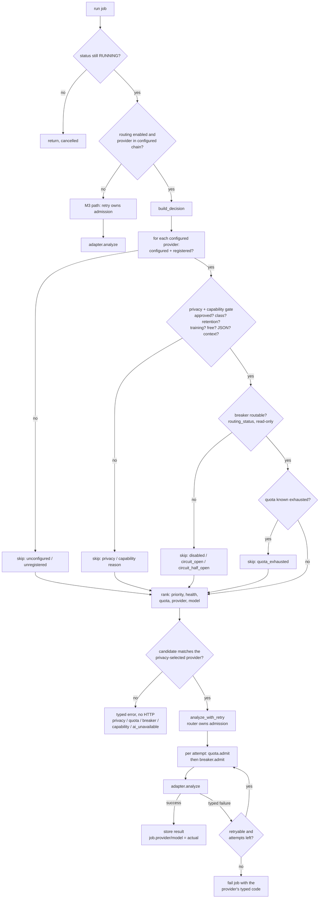

# Stage 2 — AI Provider Architecture (revised)

Design for a **privacy-gated**, free-only, quota-aware multi-provider AI layer behind the existing
analyzer.

- Status: **B1, B2 and B3 implemented.** See `docs/STAGE2_B1_IMPLEMENTATION_REPORT.md`,
  `docs/STAGE2_B2_IMPLEMENTATION_REPORT.md` and `docs/STAGE2_B3_FINAL_REPORT.md`. §0 is the B2
  as-built subset; §9, §11, §14 and §15 were updated to the B3 as-built. Sections still marked
  *Target* describe B4 work that does not exist yet.
- Research backing: `docs/STAGE2_AI_PROVIDER_RESEARCH.md`, re-verified 2026-11-22.
- Revision: implements the privacy-first review. The two substantive reversals are (a) **privacy is a
  gate that runs before capability and quota**, and (b) **the only privacy-approved provider today is
  Cloudflare**, so the default chain has no cross-provider fallback until Groq or OpenRouter clears
  the gate.

Constraints carried in, unchanged: free-only by default, no silent paid fallback, no new Python
dependencies, no vendor SDK, no schema change. B1 and B2 are implemented; B2 makes the privacy gate
live, so Gemini is no longer a resume processor. A machine without Cloudflare credentials fails
analysis explicitly rather than falling back.

## 0. As built in B2 (authoritative for current behaviour)

Resume content leaves the host only through this path:

```
services/analysis.py:run()
  └─ registry.get_provider() → router.select_provider(settings)
        ├─ privacy.approved_candidates(settings)   gate, no I/O
        │     └─ first row that passes → providers.build_adapter(...)
        └─ configured provider refused by the gate → ProviderPrivacyDenied
  └─ provider.analyze(request)
        └─ cloudflare.CloudflareProvider → POST api.cloudflare.com/client/v4/.../ai/run/{model}
              └─ repair.validate_or_repair(raw, max_repairs=0)
```

Implemented files:

| File | As-built behaviour |
|---|---|
| `ai/privacy.py` | `denial_reasons()` and `approved_candidates()`; eight checks (§2.2 items 1–5 plus free-only, JSON, context); unknown is denial |
| `ai/router.py` | One provider, no runtime loop/fallback; raises `ProviderPrivacyDenied` when a configured provider fails the gate |
| `ai/cloudflare.py` | Native REST adapter, `messages` + `max_tokens=4096` + `response_format={"type":"json_object"}`, one 5xx retry, typed errors, no repair |
| `ai/providers.py` | `PROVIDERS`, `configured_model()`, `build_adapter()`; construction does not gate, so it is never called before `approved_candidates()` |
| `ai/registry.py` | `get_provider()` → `select_provider(get_settings())` |
| `ai/models.py` | Unchanged from B1; only the Cloudflare 70B row is `eligible_for_resume` |
| `core/config.py` | `AI_PROVIDER_ORDER`, `AI_APPROVED_PROVIDERS`, `AI_FREE_ONLY`, `AI_ALLOW_TRAINING_PROVIDERS`, `CLOUDFLARE_*`, existing timeout |
| `core/logging.py` | Allowlist formatter; unknown extras dropped; exception type + location only, never the message; `httpx` pinned to WARNING so request URLs (which carry the account id) are never formatted |
| `services/analysis.py` | `provider_privacy_denied` vs `ai_not_configured`; empty provider/model when nothing was selected |

Not implemented in B2 (target at that time): `health.py`, `quota.py`, `probe()`, `log_event()`, startup
privacy self-check, `AI_MAX_ATTEMPTS`, attempt loop, cross-provider fallback, Groq/OpenRouter/OpenAI
adapters, region rules, in-product processor notice. B3 has since implemented the health manager,
quota manager, router/attempt loop, retry policy and allowlist observability: §9, §11, §14 and §15
below now describe the B3 as-built. `log_event()`, the startup self-check, active probes, fallback and
the extra adapters remain unimplemented.

B2 verification was mocked. Live status: two approved attempts with synthetic text were rejected at the
edge with HTTP 401 (`provider_auth_failed`), so no model response exists yet and the adapter's real JSON
behaviour is unverified. See `docs/STAGE2_B2_IMPLEMENTATION_REPORT.md`.

## 1. What existed before B2

```
POST /api/v1/analyses
  └─ services/analysis.py:submit()      provider name+model hashed into input_hash
  └─ BackgroundTasks → services/analysis.py:run()
        └─ ai/registry.py:get_provider()  → GeminiProvider | None
              └─ ai/gemini.py:_generate() → POST generativelanguage.googleapis.com
                    └─ ai/prompts.py build_prompt()
                    └─ ai/output.py  AnalysisOutput.model_validate()
                          └─ one repair attempt on ValidationError (MAX_REPAIRS = 1)
```

Facts that constrain the design (each read from the repository, not assumed):

| Fact | Consequence |
|---|---|
| `AnalysisProvider` is a `Protocol` with `name`, `model`, `analyze(request) -> AnalysisOutput` | New providers slot in without touching `services/analysis.py` |
| `run()` catches `ProviderError` and persists `code`/`message` through `_fail()` | A router can fail a job precisely with no new plumbing |
| `_fail()` truncates `error_message` to 2000 chars and stores it on the job | Provider text must never reach `message`, or it becomes a stored, user-visible leak |
| `job.provider` / `job.model` are set at submit time and are not in the DB uniqueness key | A fallback may update them post-hoc; no migration |
| `input_hash` includes `provider` + `model` **as resolved at submit time** | Changing the default provider changes hashes for *new* submissions only; existing rows keep theirs |
| Gemini client is plain `httpx`, one sleep-retry, retryable `{429,500,502,503,504}` | Error classification already has a precedent to generalise |
| `core/logging.py` copies **every** non-reserved `extra` key into the JSON record | Any new adapter field is logged by default. This is the reason for the allowlist in §10 |
| `core/logging.py` sets `sqlalchemy.engine.Engine` to WARNING | SQL containing `extracted_text` is not echoed. Existing control, keep it |
| `Settings` is pydantic-settings with `AI_*` / per-provider prefixes | New config follows the same convention |

## 2. Privacy model

### 2.1 Data classes

One class is processed in this stage:

| Class | Contents | Leaves the host? |
|---|---|---|
| `resume_pii` | Extracted resume text + job-description text + JD title/company | Yes, to an AI processor |

`RESUME_DATA_CLASS = "resume_pii"` is a module constant in `ai/models.py`. It is not configurable: a
knob that lets an operator widen the class is a knob that disables the control.

### 2.2 The gate

A candidate may receive `resume_pii` only if **all** of the following hold, in this order:

| # | Gate | Failure reason code |
|---|---|---|
| 1 | Provider name appears in `AI_APPROVED_PROVIDERS` | `not_approved` |
| 2 | Registry row lists `RESUME_DATA_CLASS` in `approved_data_classes` | `data_class_not_approved` |
| 3 | Registry row records `retention` and `trains_on_content=False`, both with `privacy_verified_on` | `privacy_unverified` |
| 4 | `AI_FREE_ONLY` is false **or** row has `free_tier=True` | `not_free` |
| 5 | Row has `json_output=True` | `no_json` |
| 6 | Provider key/account is configured | `unconfigured` |
| 7 | Breaker is not `OPEN` | `circuit_open` |
| 8 | Quota bucket has room | `quota_exhausted` / `account_exhausted` |

Gates 1–3 are the privacy gate. It is evaluated **before any network call** and before capability,
so a provider that is cheap and capable but undocumented never becomes reachable by reordering config.

**As built (B2):** `denial_reasons()` implements rows 1–5 plus free-only, JSON output and context.
Rows 6–8 (configuration, breaker, quota) are not part of the B2 gate: configuration is handled by
adapter construction, and the breaker/quota managers do not exist yet.

Three consequences that the review asked for explicitly:

- **Free-tier eligibility is not privacy eligibility.** Gate 4 is below gates 1–3. A free provider
  with an undocumented training policy fails at gate 3 and its free allowance is irrelevant.
- **Unknown is denied.** A registry row with no `privacy_verified_on` date, or with
  `retention="unknown"`, is ineligible. Silence is treated as "may train".
- **The allowlist is necessary but not sufficient.** Adding a name to `AI_APPROVED_PROVIDERS` cannot
  make an undocumented provider eligible; it only *removes* providers from the eligible set. Both
  the allowlist and the registry evidence are required. This is why the allowlist is safe to expose
  as an env var while the evidence is not.

### 2.3 Why the default is `false`

`AI_ALLOW_TRAINING_PROVIDERS` defaults to **false**. When false, a row with `trains_on_content=True`
is skipped with reason `training_not_allowed`, and `trains_on_content="unknown"` is always skipped
(`training_unknown`). As built in B2, the flag only removes one denial reason: it cannot override the
registry. Gemini stays ineligible because it has no approved data class. There is no startup waiver
log in B2.

### 2.4 Provider decision, as it affects the code

From research §1 and §9:

| Provider | Data class approval | In the default chain? |
|---|---|---|
| Cloudflare Workers AI | `resume_pii` approved (zero retention, no training, documented) | **Yes**, sole member |
| Gemini free | Not approved (trains, human review possible) | No — registry denies |
| Groq | Not approved (training not documented) | No — conditional |
| OpenRouter | Not approved (policy depends on upstream endpoint) | No — conditional |
| OpenAI | Policy passes, no free tier | No — excluded |

The chain therefore has **exactly one processor**, which means cross-provider fallback is disabled by
design today. That is a deliberate availability-for-privacy trade, stated here so it is not
discovered later as a bug.

### 2.5 Fallback disclosure

When a second provider becomes approved, a single resume can be transmitted to more than one external
processor in one request: attempt 1 to provider A, attempt 2 to provider B. The router does not
re-send on privacy grounds — trying the **next approved** provider is the intended behaviour — but the
user-facing consequence must be documented and, before any second provider is enabled, surfaced in
the product's privacy notice.

Requirements attached to enabling a second provider (blocking, not advisory):

1. The privacy notice lists each processor that may receive a resume, by name.
2. `AI_APPROVED_PROVIDERS` names the same set.
3. The fallback set is homogeneous in data class: every member is approved for `resume_pii`.
4. If no approved provider remains, the job fails with `ai_unavailable` and a message that does **not**
   invite the user to retry on a different provider. The resume is not sent anywhere.

No UI change is made in Stage 2. Since the code cannot display a notice, enabling a **second**
provider is blocked until a notice exists. Today's single-provider chain needs no new notice beyond
documenting the one processor.

## 3. Target component diagram

```
                       services/analysis.py:run()
                                  │  provider.analyze(request)
                                  ▼
                        ┌────────────────────┐
                        │   RoutedProvider   │  ← the only object registry returns
                        │  (ai/router.py)    │
                        └─────────┬──────────┘
             ┌────────────────────┼─────────────────────┐
             ▼                    ▼                     ▼
    ┌────────────────┐   ┌────────────────┐   ┌──────────────────┐
    │ PrivacyGate    │   │ HealthManager  │   │  QuotaManager    │
    │ (allowlist +   │   │ (breaker FSM)  │   │  (buckets)       │
    │  registry)     │   └────────────────┘   └──────────────────┘
    └────────────────┘            │                     │
             └────────── candidate ordering ────────────┘
                                  │
        ┌───────────┬─────────────┼─────────────┬──────────────┐
        ▼           ▼             ▼             ▼              ▼
 CloudflareAdapter GeminiAdapter  GroqAdapter  OpenRouterAdapter  (OpenAI: disabled)
        │           │             │             │
        └───────────┴─────── httpx (no SDK) ────┘
```

Module layout (new files under `backend/app/ai/`). **Target only** — the B2 subset is the list in §0;
`health.py`, `quota.py`, `adapters/` and `errors.py` (errors live in `base.py`) do not exist yet:

| File | Purpose | Approx. size |
|---|---|---|
| `models.py` | model + privacy registry, `RESUME_DATA_CLASS` | ~70 lines |
| `providers.py` | provider registry + `build_adapters(settings)` | ~60 lines |
| `privacy.py` | the gate itself, pure functions over registry rows + settings | ~50 lines |
| `quota.py` | quota buckets, reset clocks, header ingestion | ~120 lines |
| `health.py` | circuit breaker per provider and per model | ~90 lines |
| `router.py` | ordered selection, attempt loop, classification | ~150 lines |
| `adapters/{cloudflare,groq,openrouter}.py` | REST adapters | ~90 lines each |
| `errors.py` | `ProviderRateLimited`, `ProviderAuthFailed`, `ProviderBlocked`, `ProviderPrivacyDenied` | ~30 lines |

Modified, later phases only: `base.py` (error subclasses), `registry.py` (returns `RoutedProvider`),
`config.py` (new `AI_*` settings), `core/logging.py` (allowlist formatter + `log_event`),
`services/analysis.py` (replace the one `logger.exception`; no logic change), `gemini.py` (reuse the
shared repair helper; no behavioural change).

Deliberately **not** built: queue/worker, per-user quotas, provider dashboard, plugin system,
persisted breaker/quota state, streaming, ensembles.

## 4. Provider adapter interface

The interface is the one that already exists. No second abstraction layer.

```python
class ProviderRateLimited(ProviderError):
    code = "provider_rate_limited"
    retry_after_seconds: float | None = None

class ProviderAuthFailed(ProviderError):
    code = "provider_auth_failed"

class ProviderBlocked(ProviderError):
    code = "provider_blocked"          # content policy / safety refusal

class ProviderPrivacyDenied(ProviderError):
    code = "provider_privacy_denied"   # raised only by the gate, never by an adapter


class AnalysisProvider(Protocol):
    name: str          # "gemini" | "groq" | "cloudflare" | "openrouter"
    model: str         # exact provider model id
    scope: str         # "model" (per-model bucket) | "account" (shared bucket)

    def analyze(self, request: AnalysisRequest) -> AnalysisOutput: ...
    def probe(self) -> None: ...       # used only by HALF_OPEN
```

`scope` is the one genuinely new protocol field, and it is what makes honest quota accounting
possible: Cloudflare and OpenRouter share one account-level bucket across models; Gemini and Groq do
not (research §8). Adapters declare their shape; the router does not guess.

Adapter contract, enforced by a shared `HttpAdapter` base:

1. Build the provider request from `prompts.build_prompt(...)`. The prompt text stays identical across
   providers so quality comparisons mean something.
2. Require documented structured output. No prompt-only "reply in JSON". A provider without a
   documented JSON mode is not registered as capable.
3. Parse into `AnalysisOutput` via the shared repair helper lifted from `gemini.py`:
   `validate_or_repair(raw, regenerate, provider_name)`. Gemini keeps `MAX_REPAIRS = 1`; new adapters
   start with 0, because a second provider is a better repair than a second prompt.
4. Map provider signals to the taxonomy exactly once, in one shared function:

| Provider signal | Raised | Router reaction |
|---|---|---|
| 429, or quota exhausted per headers | `ProviderRateLimited` (+`retry_after`) | mark bucket, try next **approved** candidate |
| 401 / 403 / invalid-key signal | `ProviderAuthFailed` | disable that provider for the process, try next approved candidate |
| timeout / connect error | `ProviderTimeout` / `ProviderUnavailable` | count against health, try next approved candidate |
| 5xx after the adapter's own single retry | `ProviderUnavailable` | count against health, try next approved candidate |
| safety refusal / empty candidate | `ProviderBlocked` | **no fallback**, fail job |
| 400 invalid request | `ProviderError(code="provider_rejected")` | **no fallback** (our bug) |
| JSON invalid after repairs | `ProviderInvalidOutput` | try next approved candidate once |

5. **Error text is fixed.** Adapters construct `ProviderError` with a stable, content-free message
   (e.g. `"Cloudflare rejected the request."`). Provider response bodies are never copied into
   `message`, `str(exc)`, a log field or the job row. A machine error code may be extracted only if it
   matches `^[a-z0-9_.-]{1,40}$`, and even then it is emitted as `code`, not `message`.

Keys come from `Settings` only, live on the adapter instance, and are never passed to `ProviderError`.

## 5. Model registry (verified facts only)

`models.py` is data. Every entry was read from official documentation, and an entry without
`privacy_verified_on` is not eligible for routing.

```python
@dataclass(frozen=True)
class ModelSpec:
    provider: str
    model_id: str
    free_tier: bool
    json_output: bool
    json_mode_notes: str
    context_tokens: int
    scope: Literal["model", "account"]
    retention: str                       # "zero" | "<=30d" | "unknown"
    trains_on_content: bool | Literal["unknown"]
    approved_data_classes: frozenset[str]
    capability_verified_on: str          # ISO date
    privacy_verified_on: str | None      # None = not eligible
```

Initial registry, matching the research doc exactly:

| Provider | Model | Free | JSON out | Context | Scope | Retention | Trains | Data class | Privacy verified |
|---|---|---|---|---|---|---|---|---|---|
| cloudflare | `@cf/meta/llama-3.3-70b-instruct-fp8-fast` | yes | yes (JSON Mode) | **24,000** | account | zero | no | `resume_pii` | 2026-11-22 |
| cloudflare | `@cf/meta/llama-3.1-8b-instruct` | yes | yes (JSON Mode) | unknown (disabled) | account | zero | no | `resume_pii` | 2026-11-22 |
| gemini | `gemini-3.5-flash-lite` | yes | yes | 1,048,576 | model | free tier retained | **yes** | *(none)* | — |
| groq | `openai/gpt-oss-120b` | yes | yes (`strict: true`) | 131,072 | model | ≤30d | **unknown** | *(none)* | — |
| groq | `openai/gpt-oss-20b` | yes | yes (`strict: true`) | 131,072 | model | ≤30d | **unknown** | *(none)* | — |
| openrouter | `:free` entry, pinned at B3 | yes | per endpoint | per entry | account | upstream | upstream | *(none)* | — |

Only the 70B row is enabled for routing. The 8B row is listed for the B2 decision and stays out of
the router until its context window is verified.

Corrections carried in from verification (research §12):

- `@cf/openai/gpt-oss-*` is **not** in Cloudflare's JSON Mode model list. The earlier draft's
  Cloudflare model was wrong; it is withdrawn.
- Cloudflare `max_tokens` defaults to **256**, so the adapter must always send it explicitly.
- Groq `strict: true` is confirmed for `gpt-oss-120b` / `gpt-oss-20b`; the earlier "verify" is resolved.
- OpenRouter sends no `X-RateLimit-*` headers on success; quota comes from `GET /api/v1/key`.
- Cloudflare's 70B model has a **24,000-token** context, not 128k. Input must be budgeted per model.

Rules encoded in the registry, not in prose:

- `free_tier is False` → never a candidate while `AI_FREE_ONLY=true`.
- `json_output is False` → never a candidate.
- `RESUME_DATA_CLASS not in approved_data_classes` → never a candidate for resume work.
- `scope == "account"` → no "reset by switching model" inside that provider.
- A model not listed → not routable. Adding one is a code change with dates, never a catalogue guess.
- OpenRouter must be pinned to `:free` ids. A missing free entry means "unavailable", never "use the
  paid slug".

## 6. Data budgeting — the 24k context is a real constraint

`_require_text` allows up to 400,000 extracted characters. Cloudflare's approved model accepts 24,000
tokens. The adapter therefore budgets before sending:

| Input | Rule |
|---|---|
| Resume | Never silently truncated. If resume + JD + prompt + output reserve exceeds the model budget, fail with `resume_too_large_for_provider`, not a cut. **As built:** the JD is included in the estimate and is not truncated either; the request fails before any network call. |
| Job description | Included in the same budget. The target design allows a marked tail truncation; B2 does not implement it. |
| Output reserve | `max_tokens` fixed at 4096 (well under the model's output ceiling) because the Cloudflare default of 256 truncates the JSON. |

Truncation policy is deterministic and logged as `truncated_chars` (a count, never the text).

## 7. Router: deterministic, ordered, explainable — *Target; B2 selects one provider and stops*

No scoring, no randomness. Order comes from config; the router only filters.

```
candidates = [
    (spec.provider, spec.model_id)
    for provider in settings.ai_provider_chain
    for spec in registry.models_for(provider)      # registry order
    if privacy_gate(spec, settings) is None        # gates 1-3
]
```

Then the remaining gates (§2.2 items 4–8) are applied per candidate, cheapest first:

| Check | Skip when | Reason code |
|---|---|---|
| free-only | `AI_FREE_ONLY and not spec.free_tier` | `not_free` |
| capability | `not spec.json_output` | `no_json` |
| configured | missing key / account id | `unconfigured` |
| health | breaker `OPEN` | `circuit_open` |
| account scope | `(provider, account)` bucket already exhausted this request | `account_exhausted` |
| model quota | bucket says `remaining == 0` and reset not passed | `quota_exhausted` |

Attempt loop:

1. Take the first surviving candidate; `attempted.append((provider, model))`.
2. Re-assert the privacy gate immediately before the call (cheap, and it makes the invariant local).
3. Call `adapter.analyze(request)`.
4. Success → return `AnalysisOutput` + the candidate that produced it.
5. Transient/quality failure → update quota/health, loop, up to `AI_MAX_ATTEMPTS` (default 3).
6. `ProviderBlocked` / `provider_rejected` → stop, terminal error, no fallback.
7. `ProviderAuthFailed` → disable that provider for the process, then continue only if another
   **privacy-approved** candidate exists; otherwise stop.
8. No candidates at all → `ai_unavailable` (§7.2).

Determinism guarantees:

- Same config + same bucket state → same order. Nothing is sampled.
- The privacy gate runs before any network call, so an unapproved provider listed first is never
  reached.
- Every skip and failure emits one structured record with `provider`, `model`, `reason` — and no
  content (§10).

### 7.1 Authentication failure — one rule, stated once

The earlier draft contradicted itself (its error table said "try next", its attempt loop said "stop").
The single rule is:

> An authentication failure disables **that provider** for the process. The router continues only to
> a candidate that is itself privacy-approved and still healthy. With today's single-provider chain,
> an auth failure is therefore terminal for the request.

Concretely: `ProviderAuthFailed` is never counted against the shared health breaker (it is not
transient), it is logged once at ERROR with `provider` + `http_status` only, and the provider is added
to a process-local `disabled` set. If every approved provider is disabled or unapproved, the job fails
with `ai_unavailable`; if no provider is configured at all, with `ai_not_configured`.

### 7.2 Failure surface to the user

Uses the existing `_fail()` path, so no API change and no migration.

| Situation | `error_code` | Message intent |
|---|---|---|
| No provider configured | `ai_not_configured` | name the AI config, not only `GEMINI_API_KEY` |
| No **privacy-approved** provider available | `ai_unavailable` | "Resume analysis is temporarily unavailable." No invitation to retry elsewhere |
| Candidates existed, all transiently failed | `ai_unavailable` | "Free AI providers are busy. Try again in a few minutes." |
| All approved candidates exhausted daily allowance | `ai_quota_exhausted` | reset time when documented |
| Content blocked | `provider_blocked` | existing message, no fallback |
| Resume exceeds the model budget | `resume_too_large_for_provider` | actionable, no data sent |

No new error code is introduced beyond these; `error_code` is an existing string column, so no schema
change is implied.

## 8. Failure scenarios

| # | Scenario | Detection | Router action | User sees |
|---|---|---|---|---|
| 1 | Only approved provider has no key | `unconfigured` | no candidates | `ai_not_configured` |
| 2 | Approved provider rate-limited | `ProviderRateLimited` + headers | set `exhausted_until`, skip provider | `ai_quota_exhausted` if nothing else approved |
| 3 | Approved provider down / slow | timeout, 5xx, DNS | breaker failure++, next approved candidate | `ai_unavailable` |
| 4 | Unusable JSON | `ProviderInvalidOutput` | try next approved candidate once, never same model twice | `ai_unavailable` |
| 5 | Key rejected (401/403) | `ProviderAuthFailed` | disable provider for process; continue only if another approved candidate exists | `ai_unavailable` |
| 6 | Account-wide free pool empty | account bucket | skip every model of that provider | `ai_quota_exhausted` |
| 7 | **A provider is free and capable but not privacy-approved** | gate reason `not_approved` / `data_class_not_approved` / `privacy_unverified` | **never contacted**; no fallback to it, even if it is the last candidate | `ai_unavailable` |
| 8 | All approved providers unavailable | empty candidate list / attempts exhausted | fail safely; no paid escalation | retryable wording |

Cases with **no** fallback, by design: content blocked (every provider refuses the same content and
resubmission looks like abuse), invalid request (our bug), cancellation (job is `CANCELLED`; the
router checks status before the next attempt), and **privacy-denied** (sending anyway is the failure
mode the review exists to prevent).

Partial success is impossible by construction: `AnalysisOutput` is stored only when a candidate
returns a fully validated object.

## 9. Health manager and circuit breaker — **implemented in B3 (M2-A, M2-B)**

In-process, per `(provider)` and per `(provider, model)`. No persistence; a restart resets to
`CLOSED`, and the worst outcome is one extra failed attempt.

```
CLOSED ──(N consecutive transient failures)──▶ OPEN
OPEN   ──(cooldown elapsed)──▶ HALF_OPEN
HALF_OPEN ──(probe succeeds)──▶ CLOSED
HALF_OPEN ──(probe fails)─────▶ OPEN   (cooldown doubles, capped)
```

### 9.1 As-built files

| File | Responsibility |
|---|---|
| `ai/health.py` | `HealthRecord`, `InMemoryHealthStore`, `classify_failure()`, `BreakerPolicy.from_settings()`; `routing_status()` is the read-only routing view and `admit()` claims the single half-open probe |
| `ai/retry.py` | Records success/failure and latency per attempt; calls `health.admit()` only when the router does not own admission |
| `ai/router.py` | Filters candidates with `routing_status()` and admits through `admit()` immediately before execution |
| `services/analysis.py` | Holds the process-local `health_store`; a disabled policy makes admission a no-op but evidence is still recorded |

### 9.2 Classification and thresholds

- **Transient** (`ProviderTimeout`, `ProviderUnavailable`, `ProviderNetworkError`): increments the
  consecutive-failure counter and can open the breaker.
- **Quality** (`ProviderInvalidOutput`, schema/JSON errors): model-level evidence only; does not open
  the breaker.
- **Auth / permission** (`ProviderAuthFailed`, `ProviderPermissionDenied`): disables the provider for
  the process until credentials recover; not a transient failure.
- **Not counted:** `ProviderRateLimited` / `ProviderQuotaExhausted` (quota, not health),
  `ProviderBlocked` (our input), and unknown errors.
- Defaults: `AI_BREAKER_FAILURES=3`, `AI_BREAKER_COOLDOWN_SECONDS=120`, cap 900,
  `AI_BREAKER_BACKOFF_MULTIPLIER=2.0`. `AI_BREAKER_ENABLED=false` makes admission a no-op while
  latency and outcome recording continue (M2-A behaviour).
- Clock is injected (`now: Callable[[], float]`) so tests advance time without sleeping.

### 9.3 Admission

`routing_status()` answers "could this be attempted now?" without consuming anything: an open
breaker whose cooldown has elapsed reports `half_open` and remains routable. `admit()` then claims
the probe atomically under the store lock, so only one concurrent request passes. Quota admission
runs before breaker admission (see §11) so a quota rejection never burns the probe.

### 9.4 Limits

- Provider-level breaker covers auth/DNS-wide problems; model-level records cover one overloaded
  model. Ranking reads both.
- No active probing: the half-open probe is a real user request.
- Process-local only; multi-worker sharing is deferred to M7.

## 10. Logging: allowlist only

The previous draft proposed a deny-list of sensitive field names. A deny-list fails open: any new
field name is logged until someone remembers to add it. This revision inverts the default.

### 10.1 Two enforcement points

**As built in B2:** the formatter half exists. `log_event()` does not; call sites pass allowlisted
names directly. The table below is the target contract.

1. **Emitter: `log_event(logger, event, *, level=logging.INFO, **fields)`.** `event` must be a
   constant from a small known set. `fields` are filtered against `ALLOWED_LOG_FIELDS`; unknown keys
   are dropped and replaced by `dropped_fields=<count>`.
2. **Formatter: `JsonFormatter`.** `record.__dict__` extras are filtered by the same
   `ALLOWED_LOG_FIELDS`; unknown keys never reach the output, including for third-party libraries.

```python
ALLOWED_LOG_FIELDS = frozenset({
    "event", "code", "reason", "provider", "model", "scope", "free_tier",
    "attempt", "status", "http_status", "latency_ms", "tokens_in", "tokens_out",
    "resets_at", "truncated_chars", "job_id", "owner_id", "score",
    "request_id", "mysql", "env", "recovered_analyses", "dropped_fields",
})
```

Allowlist, not denylist, is what makes the following impossible rather than merely discouraged:

| Never logged | Why the control holds |
|---|---|
| Prompt text, resume text, JD text | no allowed field name exists for content; `record.getMessage()` is a constant event string |
| API keys, `Authorization` headers | keys live on adapter instances; no allowed field; adapters never put them in exceptions |
| Provider response bodies | adapters use fixed messages; only a validated `code` and `http_status` may be emitted |
| Exception messages | `log_event` accepts `exc_type` (class name) only. The one generic `logger.exception` in `analysis.run()` is replaced with `log_event(..., code="internal_error", exc_type=type(exc).__name__)` |

Tracebacks are still available in development because `configure_logging` keeps the console handler;
in production the record carries type + code, not free-form text. That is a deliberate loss of
debuggability in exchange for a structural guarantee.

### 10.2 Error messages (not just logs)

`_fail()` stores `error_message` on the job and the UI shows it, so it is a second egress path.
Rules:

- Adapter errors use fixed messages; no provider text, no key, no content.
- `_fail()` keeps its 2000-char truncation as defence in depth.
- `provider_rejected` never includes the offending request body.

### 10.3 Tests with identifiable dummy strings

| Test | Assertion |
|---|---|
| Formatter drops unknown extras | log `{"prompt": RESUME_CANARY, "api_key": KEY_CANARY}` → payload has neither key nor value, `dropped_fields == 2` |
| `log_event` filters fields | same, through the helper |
| Adapter 401/500 paths | `str(exc)`, `exc.message`, and captured log output contain no `KEY_CANARY` |
| Full analysis failure path | `job.error_message` contains none of `RESUME_CANARY`, `JD_CANARY`, `KEY_CANARY` |
| `log_event` with `exc` object | exception message is not serialised; only `exc_type` appears |

Canaries: `RESUME_CANARY_7f3c9a`, `JD_CANARY_41bd07`, `sk-CANARY-0000-not-a-key`,
`Bearer CANARY`. They are deliberately grep-able so a leak in CI output is obvious.

## 11. Quota vs billing — **implemented in B3 (M3)**

| Provider | Quota object | Scope | Model switch buys a new bucket? | Money at risk |
|---|---|---|---|---|
| Gemini | RPM/TPM/RPD per model | project × model | yes | none while billing is unlinked |
| Groq | RPM/RPD/TPM/TPD per model | organization × model | yes | none on Free plan |
| Cloudflare | **Neurons/day** | **account**, all models | **no** | none on Workers Free |
| Cloudflare | 300 RPM text generation | account × task type | no | none |
| OpenRouter | Free requests/day | **account**, all free models | **no** | none unless credits purchased |
| OpenAI | Tiered org limits | org/project | n/a | every request bills |

Bucket shapes: `model` (Gemini, Groq), `account` (Cloudflare, OpenRouter), monetary (unreachable in
this stage).

Rules the code enforces:

- **A 429 is not a billing event.** It costs nothing and never triggers a paid path.
- **No cross-provider fallback.** Exhaustion blocks the selected provider and fails the job with
  `provider_quota_exhausted`; no other provider is contacted. (Fallback is deferred and disabled.)
- **Billing is not a fallback signal.** There is no code path that reads `openai_api_key` while
  `AI_FREE_ONLY=true`, and paid escalation additionally requires a positive `AI_MONTHLY_BUDGET_USD`
  which the requirement never sets.
- **Purchasing OpenRouter credits to raise a free cap is a billing event** and is out of scope
  without explicit approval (research §5).
- Failed requests are not counted as consumed; our counters move only on requests we issued.

### 11.1 As-built bucket

```python
@dataclass
class QuotaBucket:
    remaining: int | None               # None = unknown; provider publishes nothing usable
    limit: int | None
    unit: str | None
    resets_at: float | None             # epoch seconds, only from a documented clock/header
    exhausted_until: float | None       # set on confirmed exhaustion
    exhausted_unknown_reset: bool       # exhaustion with no usable reset: blocked until re-observed
    exhausted_source: str | None        # "error_3036" is protected until its reset
    rate_limited_until: float | None    # temporary 429 / 3040 window
```

`QuotaStore` is the protocol (`get`, `observe`, `admit`, `snapshot`, `reset`);
`InMemoryQuotaStore` is the process-local implementation. `QuotaPolicy.from_settings()` reads
`AI_QUOTA_ENABLED` per call, so the flag needs no restart.

### 11.2 Lifecycle as implemented

1. **Before an attempt:** `admit()` rejects only known exhaustion. Unknown is `None`, never zero and
   never unlimited, and does not block. A temporary rate limit does not block admission — retry
   timing stays owned by `retry.py`.
2. **On 429:** error `3036` is confirmed daily exhaustion; the documented 00:00 UTC reset is the only
   reset time used (`next_utc_midnight`). Error `3040` and other 429s are temporary rate limits and
   keep `Retry-After` when it is a valid non-negative number.
3. **Exhaustion without a reset time** stays blocked (`exhausted_unknown_reset`) until a later
   authoritative observation; no conservative window is invented.
4. **A protected `3036` window cannot be cleared early** by success, generic 429/3040, malformed
   evidence or an explicit `remaining > 0`. Reaching the reset clears it back to `unknown`, not to a
   refilled counter.
5. **Account scope** (`Cloudflare`) shares one bucket across models; `model` scope (other providers)
   does not.
6. **No persistence, no migration.** After a restart the estimate is unknown/optimistic until the
   first 429 or observation; the failure mode is one wasted attempt, never spend.
7. `AI_QUOTA_ENABLED=false` makes admission a no-op; quota evidence is still recorded.

Cloudflare publishes no remaining-capacity or limit header for Workers AI, so `remaining`, `limit`
and `unit` stay `None`. `Ratelimit` / `X-RateLimit-*` are ignored rather than misread. No account id,
token or response body is stored.

## 12. Data security assessment

Existing controls were read from the repository. "Proposed" means this document; nothing in that
column exists yet.

### 12.1 Resume storage and database access

| Existing | Proposed |
|---|---|
| Files written to `backend/storage/<kind>/<32-hex>.<ext>`, outside any web root; filename is metadata only | No change |
| 5 MB cap enforced while streaming, before persistence; signature sniffing (`%PDF-`, `PK\x03\x04` + `word/document.xml`); MIME derived from sniff | No change |
| Bytes served only by `GET /files/{id}/download`, authenticated, ownership-checked, `Cache-Control: private, no-store`, `X-Content-Type-Options: nosniff` | No change |
| Extracted resume text stored in MySQL `LONGTEXT`; app connects as a dedicated `careeros_app` user | No new copy of text is created by Stage 2; prompts are built in memory per request |
| `FileObject` stores `sha256`, size, MIME, original name; `owner_id` FK is `ON DELETE CASCADE` | No change |

### 12.2 Encryption at rest and in transit

| Existing | Proposed |
|---|---|
| **At rest: none at the application layer.** Resume files and DB rows are plaintext; no column encryption, no envelope keys. Whether the host disk is encrypted is an OS/deployment property and is not documented or verified in this repo | Document the gap; no code change. Application-level encryption is out of scope (needs key management) |
| Backup dumps are plaintext (SETUP §6) | Document as a gap; flagged risk |
| Provider calls use HTTPS via `httpx` with default certificate verification | No change; add an adapter test asserting the `https://` base URL |
| Browser → API TLS, and API → MySQL TLS, are not configured in the repo (dev is plain HTTP on localhost; `DATABASE_URL` has no `ssl_ca`) | Out of scope; documented as a production-readiness gap |
| `COOKIE_SECURE` defaults to `false`; no HSTS/redirect middleware | Out of scope; documented gap |

### 12.3 Backup retention

| Existing | Proposed |
|---|---|
| `docs/SETUP.md` §6: manual `mysqldump --single-transaction --routines`, copy `backend/storage/` alongside | None |
| No schedule, no retention policy, no encryption, no offsite copy, no documented restore test | Remaining risk; Stage 2 does not fix it |
| `backend/backups/` and `*.sql.gz` are gitignored | No change |

### 12.4 User access control

| Existing | Proposed |
|---|---|
| Single owner account created by `python -m app.cli bootstrap-owner`; no registration route, CLI refuses a second owner | No change |
| Argon2id (t=3, m=64 MiB, p=4), rehash on parameter change | No change |
| Access JWT HS256, 15 min, in memory; refresh token 256-bit opaque, SHA-256 hashed at rest, 14 days, rotating; reuse revokes the family | No change |
| Refresh cookie HttpOnly, scoped to `/api/v1/auth`; CSRF double-submit on refresh/logout | No change |
| Every repository query scoped by `owner_id`; foreign ids return 404 | No change |
| Login lockout per (IP, email); session list/revoke | No change |
| No MFA, no RBAC, no admin role, no per-user region data | Remaining risk / open question |

### 12.5 Resume deletion

| Existing | Proposed |
|---|---|
| Resumes/JDs/companies/applications archive by default; hard delete exists per resource | No change |
| Resume hard delete is blocked with `409` while referenced by an application or analysis | No change |
| On successful hard delete, versions then the `FileObject` row are removed and the file is unlinked best-effort (`unlink` failure is logged, not fatal) | No change |
| No secure erase; deleted bytes may persist on disk; backups keep the row until the dump is replaced | Remaining risk; document in the privacy notice |
| `AuditLog` rows keep identifiers and 255-char enum detail, explicitly never content | No change |

### 12.6 Third-party processing and retention

| Existing | Proposed |
|---|---|
| Exactly one processor: Gemini, called over HTTPS with resume + JD text | Move the default processor to Cloudflare (zero retention, no training, documented) |
| Gemini free tier is documented as using content to improve products, with possible human review; terms say not to submit personal information | Gemini is not selectable: the registry denies `resume_pii`, and no config flag overrides the registry |
| No DPA, no in-product notice of the processor, no per-user consent | Documented requirement; product notice is a blocking prerequisite before a **second** processor is enabled |
| Nothing about the third party is enforceable in code beyond "who receives the data" and "what we send" | State this honestly: provider retention claims are contractual, not code-enforced |
| Logs do not currently record content; SQLAlchemy engine logging is suppressed at WARNING | Allowlist-only logging now also drops unknown extras and exception messages (§0, §10) |

### 12.7 Existing vs proposed, one line each

Existing: private-by-default file storage, authenticated download, streaming size cap, signature
sniffing, Argon2id, short-lived JWT, hashed rotating refresh tokens, CSRF, per-owner scoping, login
lockout, archive-before-delete, referential delete guard, identifiers-only audit log, suppressed SQL
logging, HTTPS to the AI provider. Implemented in B2: privacy allowlist gate, data-class matching,
deny-on-unknown training policy, single-provider selection with no fallback, allowlist-only logging,
fixed adapter error text. Implemented in B3: provider-level health, quota and routing with a single
attempt owner and allowlist observability. Still target (B4): startup privacy self-check, active
health probes.

Not proposed and not fixed by Stage 2: encryption at rest, backup encryption/retention, DB TLS,
HSTS/secure cookie defaults, MFA, region enforcement, secure erase.

## 13. Config design

**As built (B2):** `ai_provider_order`, `ai_approved_providers`, `ai_free_only`,
`ai_allow_training_providers`, `ai_timeout_seconds`, `cloudflare_api_token`,
`cloudflare_account_id`, `cloudflare_model`, plus the retained `ai_provider`, `gemini_api_key` and
`gemini_model`.

**B3 additions:** `ai_max_attempts`, `ai_retry_base_delay_seconds`, `ai_retry_max_delay_seconds`,
`ai_breaker_enabled`, `ai_breaker_failures`, `ai_breaker_cooldown_seconds`,
`ai_breaker_cooldown_max_seconds`, `ai_breaker_backoff_multiplier`, `ai_quota_enabled`,
`ai_routing_enabled`, `ai_allow_cross_provider_fallback`. The code snippet below is the original
design sketch, not the as-built defaults; the authoritative table is in
`docs/STAGE2_B3_FINAL_REPORT.md` §11. Groq/OpenRouter/OpenAI fields remain target-only and are absent
from `Settings`.

Extends the existing `Settings` block; naming follows the current convention.

```python
# AI / provider chain
ai_provider: str = "gemini"                       # legacy primary; see note below
ai_provider_order: str = "cloudflare"             # privacy-approved chain only
ai_free_only: bool = True
ai_approved_providers: str = "cloudflare"         # explicit allowlist, required in addition to registry evidence
ai_allow_training_providers: bool = False         # reversed default
ai_max_attempts: int = Field(default=3, ge=1, le=5)
ai_timeout_seconds: int = Field(default=90, ge=10, le=300)
ai_breaker_failures: int = Field(default=3, ge=1, le=10)
ai_breaker_cooldown_seconds: int = Field(default=120, ge=30, le=900)

# per-provider
gemini_api_key: str | None = None
gemini_model: str = "gemini-3.5-flash-lite"
cloudflare_api_token: str | None = None
cloudflare_account_id: str | None = None
cloudflare_model: str = "@cf/meta/llama-3.3-70b-instruct-fp8-fast"
groq_api_key: str | None = None                  # present; not eligible until policy documented
groq_model: str = "openai/gpt-oss-120b"
openrouter_api_key: str | None = None
openrouter_model: str = ""                       # must be a :free id; empty = disabled
openai_api_key: str | None = None                # present; unreachable while free-only
```

Behaviour notes:

- `ai_provider` stays so existing `input_hash` values and job rows keep their meaning. **As built:** it
  seeds the chain only when `ai_provider_order` is empty; it is not prepended to an explicit order.
  Config order never overrides privacy.
- **The privacy-safe defaults are live from B2.** The router and Cloudflare adapter exist; Gemini is
  excluded by the registry. On a machine without Cloudflare credentials, analysis fails explicitly
  instead of falling back.
- Empty per-provider model string = provider disabled — how an operator unplugs a provider without
  deleting its key.
- Unknown names in the order are skipped without a warning (B2 has no startup self-check).
- `ai_configured` means "Cloudflare credentials are present and Cloudflare is allowlisted"; the gate
  remains authoritative.
- `.env.example` has placeholders only: `CLOUDFLARE_API_TOKEN=`, `CLOUDFLARE_ACCOUNT_ID=`,
  `AI_PROVIDER_ORDER`, `AI_APPROVED_PROVIDERS`, `AI_FREE_ONLY`, `AI_ALLOW_TRAINING_PROVIDERS=false`.
  Groq/OpenRouter/OpenAI fields are target-only and absent.

Startup self-check (no network, fails fast):

1. Every provider in the order is either privacy-approved or explicitly waived; otherwise WARN and
   remove it from the chain.
2. Every configured model id exists in the registry.
3. No paid model is reachable while `AI_FREE_ONLY=true`.
4. No two providers claim the same account bucket.
5. If the active chain contains a provider whose `trains_on_content` is not `False`, log one WARN
   naming it (this is the inherited Gemini risk, made visible).

## 14. Router flow — **implemented in B3 (M4)**



### 14.1 Decision order (strict)

1. Enumerate `AI_PROVIDER_ORDER`.
2. Apply the existing privacy/capability gate to each model — privacy first, unknown fails closed.
3. Apply read-only operational filters: disabled, breaker (`routing_status`), known quota exhaustion.
4. Rank survivors: configured priority → health → quota → provider → model.
5. Recompute the decision at execution time and match the privacy-selected provider; a provider that
   is not a current eligible candidate raises a typed error before any HTTP call.

### 14.2 Admission ownership

- **Routing on, in-chain provider:** the router owns admission. `route_and_run()` passes
  `admit=lambda: admit_candidate(...)`; `retry.py` then does not admit directly. Quota runs before
  the breaker so a quota rejection cannot consume the half-open probe.
- **Routing off, or provider outside the chain (test stub/plugin):** `retry.py` owns admission,
  exactly as in M3.
- Admission is re-run immediately before every attempt, so a retry cannot bypass newly exhausted
  quota or an open breaker.

### 14.3 No cross-provider fallback

The router ranks candidates but attempts **only the matched one**. `AI_ALLOW_CROSS_PROVIDER_FALLBACK`
is accepted for forward compatibility and is never read to add candidates or attempts. A failure
returns the provider's typed error; no resume content reaches another provider. Skipped candidates
are recorded in `RouteDecision.skips` and logged at DEBUG, but never called.

### 14.4 Compatibility

`select_provider()` remains the submit-time privacy-only selector and never consults health or quota.
With `AI_ROUTING_ENABLED=false`, `route_and_run()` takes the M3 path unchanged: same provider, same
retry policy, same error codes.

## 15. Implementation phases and status

| Phase | Scope | Exit criteria | Status |
|---|---|---|---|
| **B1 — Refactor under Gemini** | error classes, `models.py` with privacy fields, `providers.py`, shared `validate_or_repair`. No routing, no new provider. | existing backend tests pass; a real job still records `provider=gemini`, same model, same `input_hash` | **Done** — 84 tests passed at the time, behaviour identical |
| **B2 — Privacy gate + Cloudflare adapter** | `privacy.py`, `router.py`, Cloudflare adapter, `AI_*` settings, allowlist logging, data budgeting | gate tests; mocked adapter tests; full job flow on a mocked transport; a Gemini-only config fails `provider_privacy_denied` and sends nothing | **Done** — 137 tests passed at the time; live model response still unverified (edge 401) |
| **B3 — Provider reliability and intelligent routing** | error taxonomy (M1), health + breaker (M2), quota lifecycle (M3), centralized router with admission ownership (M4), observability (M5), docs/rollout/rollback (M6) | M0–M6 complete; full suite green; routing-off parity; privacy gate first; fallback disabled; canary tests | **Done** — 350 backend tests pass; see `docs/STAGE2_B3_FINAL_REPORT.md` |
| **B4 — Hardening** | rotate every key pasted in chat, `.env.example`, SETUP/ARCHITECTURE/DECISIONS updates (new ADR), production WARN verification | all keys rotated; paid model listed first is never called; docs match code | **Not started** |

B3's original scope in this document was "additional providers (conditional)". The implemented B3
instead hardened the single approved provider: it added the error taxonomy, breaker, quota manager,
router, admission ownership and observability. No new provider or model was approved, so the
conditional Groq/OpenRouter work remains deferred.

B3 delivered:

- `ai/health.py` (M2), `ai/quota.py` (M3), `ai/router.py` (M4), `ai/retry.py` (M1/M4).
- Privacy remains the first gate; unknown retention/training/privacy evidence denies.
- One provider is attempted; cross-provider fallback is **not** implemented and stays off.
- `AI_ROUTING_ENABLED=false` reproduces the M3 single-provider path exactly.
- Structured logs: one record per skip/attempt/terminal, allowlist only, no content.

Still unimplemented from the original B2 draft: `log_event()` (M5 logs directly through the
allowlist formatter), the startup privacy self-check, and active health probes. These are not
required for the shipped single-provider behaviour.

Explicitly out of scope for Stage 2: per-user metering, a UI provider selector, background retry
scheduling, cross-user caching, embeddings, any paid tier, schema changes, and multi-worker shared
state (M7).

## 16. Testing strategy

> **Historical B2 snapshot.** B3 supersedes this section; current coverage, exact counts and the
> milestone gates are in `docs/STAGE2_B3_TEST_STRATEGY.md` (350 backend tests at B3 completion).

**As built in B2** (exact counts in `docs/STAGE2_B2_IMPLEMENTATION_REPORT.md`): 137 tests pass, all
provider calls mocked with `httpx.MockTransport`. Gate, adapter, selection, integration, logging and
the existing suite are covered. The rows below that mention the breaker, quota, attempt loop or
`log_event` describe the target and are not implemented.

No network, no live keys, no quota consumed. `httpx.MockTransport` over `httpx.Client(transport=...)`
exercises the adapters' real request building and response parsing.

| Layer | What is asserted |
|---|---|
| Privacy gate | allowlist miss → `not_approved`; row without `privacy_verified_on` → `privacy_unverified`; `trains_on_content="unknown"` → `privacy_unverified`; Gemini free → `data_class_not_approved`; a waived provider is admitted only with the flag; a provider configured **only** by order (not allowlist) is never called |
| Adapters | URL/headers/body; key in the documented header only; 200 → `AnalysisOutput`; 429 → `ProviderRateLimited`; 500 → `ProviderUnavailable`; 401 → `ProviderAuthFailed`; malformed JSON → repair → `ProviderInvalidOutput`; Cloudflare `max_tokens` always set; 24k budget produces a too-large error, not truncation; error text contains no key and no content |
| Logging | unknown extra fields dropped; canaries never appear in `caplog`, `str(exc)`, or `job.error_message`; `exc_type` only |
| Router | each scenario in §8 produces the documented sequence and terminal error; paid model never called; unapproved provider listed first never called; account-scope exhaustion skips siblings; model-scope does not; cancelled job stops before attempt 2; auth failure disables one provider and continues only to another approved one |
| Breaker | CLOSED→OPEN at threshold; OPEN skips; HALF_OPEN admits one probe; probe failure re-opens with longer cooldown; 429 does not trip it |
| Quota | Groq header ingestion; Gemini unknown → local decrement; 429 without `retry-after` uses the conservative window; Cloudflare account bucket shared across models |
| Config | chain parsing/dedup; privacy gate cannot be overridden by order; blank model disables provider; self-check rejects a paid model under free-only |
| Existing tests | `test_analysis.py` monkeypatches `get_provider` and still passes; only its `ai_not_configured` message assertion was updated |

One integration test: three scripted candidates (429 → timeout → success) asserting `job.provider` and
`job.model` name the third, `error_code` is null, one result row exists. One negative twin: the third
candidate is unapproved, so the job fails `ai_unavailable` and that candidate is never called.

Not done: performance benchmarks, load tests, live contract tests, chaos testing. Load testing would
need a paid tier, which contradicts the constraint.

## 17. Decisions recorded before B2 (kept for history)

1. **Cutover acceptance.** B2 replaces Gemini free with Cloudflare as the resume processor. That is the
   point where the app stops sending resumes to a training provider. Confirm this is the intended
   migration, and confirm a Cloudflare account/token will be provided.
2. **Model choice within Cloudflare.** `@cf/meta/llama-3.3-70b-instruct-fp8-fast` (better quality,
   24k context) or `@cf/meta/llama-3.1-8b-instruct` (cheaper, more analyses/day, unverified context).
   The 24k budget means very long resumes become a `422`. Acceptable?
3. **Second processor.** Groq and OpenRouter stay off until their privacy gaps are closed. If a second
   processor is wanted for availability, the privacy notice must name it first. Is a notice in scope?
4. **Regional rule.** Gemini free must not serve EEA/CH/UK users, and CareerOS has no region data.
   Cloudflare has no per-request region selector documented either. Accept "no region control,
   documented" or invest in region data?
5. **Key rotation.** Values pasted in chat must be rotated before B4. Confirm they are treated as
   burned.

## 18. Risks accepted by this design

| Risk | Mitigation / honest limit |
|---|---|
| Only one approved provider → no cross-provider fallback | Deliberate. Availability is traded for privacy until a second provider clears the gate |
| Cloudflare daily allowance is small (≈414 neurons for 4k in / 1.5k out; ≈24 analyses/day for the 70B model) | Typed `ai_quota_exhausted` with the 00:00 UTC reset; buying more is out of scope |
| Cloudflare JSON Mode is documented as not schema-guaranteed | Validation + repair + fallback; quality measured in B2 |
| 24k context means long resumes cannot be analyzed on the approved model | Deterministic `422`, never a silent cut |
| In-memory breaker/quota state lost on restart | Optimistic for a few calls; corrected by the first 429; never causes spend |
| Provider policy can change after verification | `privacy_verified_on` dates; a stale row is a review item. The app cannot enforce a contract |
| No encryption at rest / backup retention / DB TLS / HSTS | Documented gaps outside Stage 2; must be fixed before any production claim |
| Logging guarantee depends on all new call sites using `log_event` | Formatter filters as a second line of defence; tests use canaries |
| Switching the default provider changes `input_hash` for new submissions | Existing rows keep their hash; an already-analyzed pair is re-analyzed once, no data loss |
| `job.error_message` is user-visible | Fixed adapter messages and truncation; canary tests cover this path |
