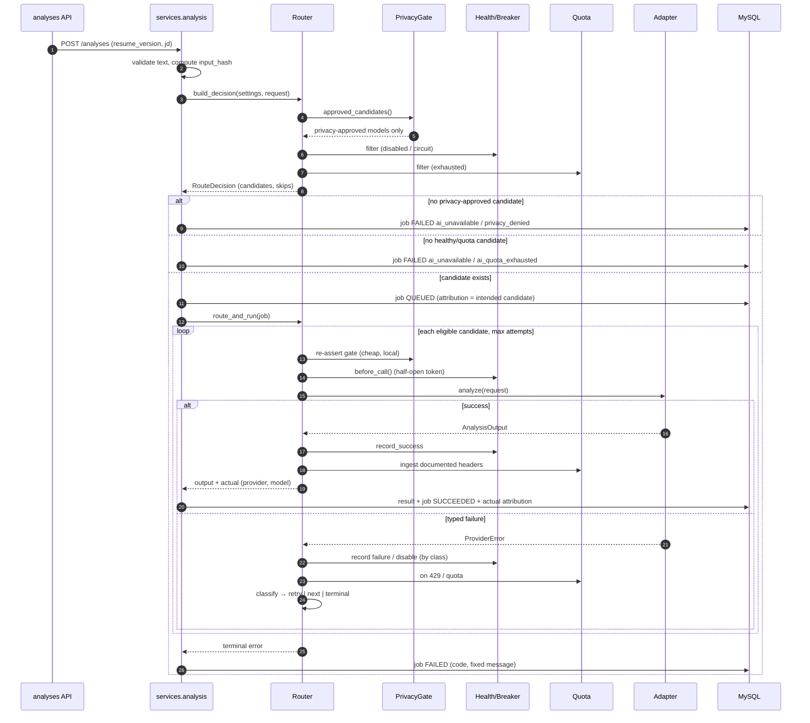
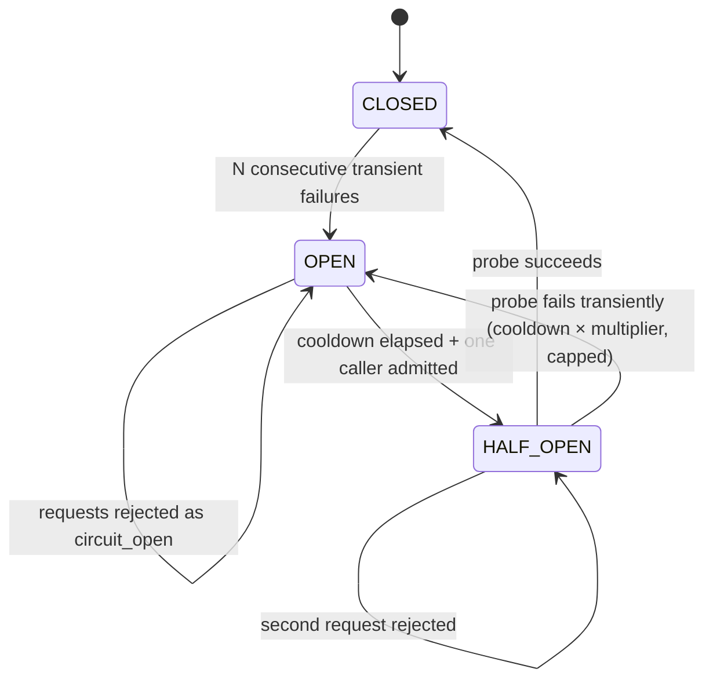
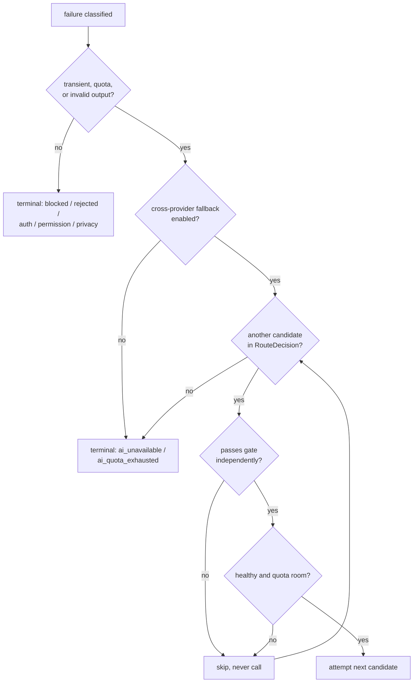

# Stage 2 — B3 Architecture: Provider Reliability & Intelligent Routing

**Status:** B3 complete (M0–M6). M1–M5 are implemented; §10 (privacy-constrained cross-provider
fallback) and M7 (multi-worker state) remain deferred. The as-built summary and exact test results are
in `docs/STAGE2_B3_FINAL_REPORT.md`.

**Companions:** `docs/STAGE2_B3_IMPLEMENTATION_PLAN.md`, `docs/STAGE2_B3_TEST_STRATEGY.md`,
`docs/STAGE2_B3_ROLLOUT.md`.

**Read with:** `docs/STAGE2_AI_ARCHITECTURE.md` §0 (as-built), `docs/STAGE2_B2_IMPLEMENTATION_REPORT.md`
(privacy gate, Cloudflare adapter, live validation).

---

## 1. Scope

B3 adds reliability and routing **around** the existing privacy gate and adapter. It does not add a
provider, does not change the approved model, and does not relax any privacy rule.

In scope:

1. Provider Health Manager (passive recorder + derived state).
2. Circuit breaker (`CLOSED` / `OPEN` / `HALF_OPEN`).
3. Quota Lifecycle Manager (documented signals only, unknown stays unknown).
4. Intelligent Router (deterministic ordered selection with an attempt loop).
5. Privacy-constrained fallback (opt-in, same gate per destination, disabled by default).
6. Error taxonomy completion, including the B2 HTTP 403 misclassification.

Out of scope for B3: new providers, new models, paid tiers, Redis, schema changes, new dependencies,
background schedulers, UI, per-user metering, streaming, ensembles.

---

## 2. Readiness assessment

### 2.1 What already exists and is reusable

| Capability | Where | State | B3 use |
|---|---|---|---|
| Typed provider errors | `backend/app/ai/base.py` | Implemented | Extend, keep codes stable |
| Provider protocol (`analyze`) | `backend/app/ai/base.py` | Implemented | Unchanged |
| Model + privacy registry | `backend/app/ai/models.py` | Implemented | Source of capability/scope facts |
| Privacy gate | `backend/app/ai/privacy.py` | Implemented, authoritative | Runs first, unchanged |
| Adapter construction | `backend/app/ai/providers.py` | Implemented | Add list-building helper |
| Single-provider selection | `backend/app/ai/router.py` | Implemented | Replaced internally by the router |
| Registry facade | `backend/app/ai/registry.py` | Implemented | Kept for compatibility |
| Cloudflare adapter | `backend/app/ai/cloudflare.py` | Implemented | 403 mapping (M1-A); one request per call (M1-B) |
| Shared validate/repair | `backend/app/ai/repair.py` | Implemented | Unchanged |
| Job persistence + polling | `app/db/models/analysis.py`, `app/services/analysis.py` | Implemented | Consume `RouteDecision` |
| Allowlist logging | `app/core/logging.py` | Implemented | Add at most two field names |
| Restart recovery | `app/services/analysis.py:recover_interrupted` | Implemented | Unchanged |

### 2.2 What is missing

| Capability | State |
|---|---|
| Health counters / latency / last success | **Implemented in M2-A** (passive, process-local) |
| Circuit breaker | **Implemented in M2-B** (provider-level, process-local); no routing/fallback |
| Quota buckets | **Implemented in M3** (account/model scope, process-local); admission owned by the router in M4 |
| Attempt loop / ordered fallback | **Router implemented in M4**; it evaluates and ranks candidates but attempts only the selected one. Cross-provider fallback is still absent |
| `RouteDecision` / skip reasons | **Implemented in M4** (`ai/router.py`) |
| Distinction auth vs permission (403) | **Implemented in M1-A** |
| Quota exhaustion vs rate limit | **Implemented in M3**; exhaustion blocks, rate limit stays with retry |
| JSON parse vs schema failure | **Implemented in M1-A** |
| Structured decision logs | **Implemented in M5** (one record per skip/attempt/terminal; allowlist only) |
| Persistence of AI state | **Absent**; process-local is the only option today |

### 2.3 Conflicts and traps found in the current code

1. **Adapter retry vs router retry.** *Resolved in M1-B.* B2 retried 5xx once inside `cloudflare.py`
   and 429/5xx once inside `gemini.py`, so one "attempt" could issue two HTTP requests. Both adapters
   now make one request per `analyze()` call; `app/ai/retry.py` owns the retry decision, the budget
   and the delay. M4 moved operational admission into `ai/router.py`; retry timing stays in
   `retry.py`.
2. **Selection at submit, execution later.** `analysis.submit()` calls `get_provider()` and stores
   `provider`/`model` on the job; `run()` calls it again. A breaker change in between makes the stored
   attribution stale. B3 records **actual** attribution on success.
3. **`input_hash` includes provider/model.** If fallback later succeeds on a different candidate, the
   dedupe key no longer describes the work done. B3 keeps the hash stable (no dedupe change) and
   documents this as a known limitation; changing it would alter idempotency semantics.
4. **One configured model per provider.** `configured_model()` returns a single model id, so
   "70B → 8B" model fallback is impossible today even if the 8B row were approved. B3 does not add a
   model list; that needs a separate setting and approval.
5. **403 conflation.** Cloudflare 403 is an entitlement/plan signal (B2 §14), not a bad key. Treating
   it as auth hides an operator action and risks a disable/retry loop.
6. **Privacy gate returns only approved candidates.** That is correct and stays. Health/quota must
   **filter** this list, never extend it.

---

## 3. Design principles

These are invariants, not preferences. Every component is tested against them.

1. **Privacy before availability.** The gate in `privacy.py` runs before health, quota, capability or
   fallback. A healthy or quota-rich provider is not a candidate unless it already passed the gate.
2. **Fail closed.** No candidate → typed failure, no outbound request. Never "try anyway".
3. **Deterministic.** Same config + same state → same order. No scoring, sampling or randomness.
4. **Unknown is not zero.** Missing quota/context/privacy facts are denial or "unknown", never a guess.
5. **Free-only is enforced before the network.** Quota logic never introduces a paid candidate.
6. **No silent data movement.** Cross-provider fallback is opt-in and off by default.
7. **One retry owner.** The router owns retries; adapters make one HTTP request per call.
8. **No new infrastructure.** In-process state, no Redis, no schema change in B3 core.
9. **Observable without content.** Every skip/attempt/failure emits one allowlisted record.

---

## 4. Component architecture

```
                    services/analysis.py:run()
                               │  route_and_run(request, ctx)
                               ▼
                 ┌─────────────────────────────┐
                 │        Router               │
                 │  (ai/router.py)             │
                 │  decision + attempt loop    │
                 └───┬───────┬────────┬────────┘
                     │       │        │
        ┌────────────▼──┐ ┌──▼─────┐ ┌▼──────────────┐
        │ PrivacyGate   │ │ Health │ │ QuotaManager  │
        │ (privacy.py)  │ │Manager │ │ (quota.py)    │
        │ authoritative │ │+breaker│ │ buckets       │
        └───────────────┘ │(health │ └───────────────┘
                          │ .py)   │
                          └───┬────┘
                              │ filters only
                     ┌────────▼─────────┐
                     │  Candidate list  │  ← from registry × config
                     └────────┬─────────┘
                              │
                    ┌─────────▼─────────┐
                    │  Adapter (one)    │  Cloudflare today
                    │  httpx, no SDK    │  Gemini disabled by gate
                    └───────────────────┘
```

Module layout (all under `backend/app/ai/`):

| File | Role | New? |
|---|---|---|
| `base.py` | Error taxonomy, protocol | modified |
| `models.py` | Registry facts | unchanged |
| `privacy.py` | Gate | unchanged |
| `providers.py` | Provider → adapter, configured model | modified (list helper) |
| `health.py` | M2-A passive recorder + M2-B provider circuit breaker, read-only states | **new** |
| `quota.py` | Quota buckets, reset/exhaustion, in-memory store | **new** |
| `router.py` | Candidate building, ordering, attempt loop, decision record | modified |
| `retry.py` | M1-B centralized retry policy (moves into router in M4) | **new** |
| `registry.py` | `get_provider()` compatibility facade | modified |
| `cloudflare.py` | 403 mapping, retry signal, no internal retry | modified |
| `gemini.py` | Align error mapping (legacy, not routed) | modified |
| `repair.py` | Validate/repair | unchanged |
| `config.py` | New `AI_*` settings | modified |
| `services/analysis.py` | Consume decision, actual attribution | modified |
| `core/logging.py` | Optional two allowlist fields | modified |

**Deliberately not built:** a queue/worker, a background health poller, a provider dashboard, a plugin
system, persisted breaker/quota state, multi-model selection, paid escalation.

---

## 5. Request lifecycle



Rules:

- Skipped candidates do not consume attempts. `AI_MAX_ATTEMPTS` counts adapter invocations.
- The gate is re-asserted immediately before each call so the invariant is local to the call site.
- A cancelled job is checked before each attempt (existing `db.refresh` pattern). **M1-B does not
  yet check between retries; M4 adds it.**
- `job.attempts` is the number of `analysis.run()` invocations. **M1-B keeps that meaning.**
  Provider attempts inside one run are not persisted; recording them needs a schema change (see
  §12). The target model (one column per layer) is deferred to M4.

### 5.1 Retry ownership in M1-B

`app/ai/retry.py` owns the retry decision, budget and delay. M4 gives it an optional `admit`
callable so `ai/router.py` owns quota/breaker admission per attempt; retry timing is unchanged.

| Error class | Retry in M1-B? | Delay |
|---|---|---|
| `ProviderAuthFailed` | no | — |
| `ProviderPermissionDenied` / `ProviderEntitlementDenied` | no | — |
| `ProviderPrivacyDenied` | no | — |
| `ProviderInvalidModel` | no | — |
| `ProviderUnsupportedCapability` | no | — |
| `ProviderBlocked` | no | — |
| `ProviderInvalidOutput` (`invalid_json`, `invalid_schema`) | no | — |
| `ProviderQuotaExhausted` | no | — |
| `ProviderRateLimited` | only with a bounded `Retry-After` | exact `Retry-After` |
| `ProviderTimeout` | bounded | exponential, capped |
| `ProviderNetworkError` | bounded | exponential, capped |
| `ProviderUnavailable` (5xx) | bounded | exponential, capped |
| other `ProviderError` (`provider_rejected`, `resume_too_large_for_provider`) | no | — |

`AI_MAX_ATTEMPTS` defaults to **2** in M1-B so the B2 effective "one retry" is preserved. The target
default in §12 is 3; raising it is a config change, not a code change.

---

## 6. Provider Health Manager

**Status: M2-A and M2-B implemented (2026-11-25).**

M2-A is passive recording plus read-only state derivation. `open` and `half_open` exist in the
type and derivation but nothing writes `opened_at` or `half_open_in_flight` yet, so no provider is
ever filtered. Health is never consulted by selection.

### 6.1 Responsibility

Record outcomes; derive a state; never select a provider. The router asks, the manager answers.

### 6.2 Tracked data (per key)

Key = `(provider)` for provider-level and `(provider, model)` for model-level.

Implemented in `backend/app/ai/health.py` (M2-A): `successes`, `failures`, `quality_failures`,
`consecutive_failures`, `last_success_at`, `last_failure_at`, `last_failure_class`,
`latency_ms_ewma`, `latency_samples`, `recent_outcomes` (bounded to 20), and the reserved
breaker fields. The sketch below is the target shape; `quality_failures` and `recent_outcomes`
were added in M2-A.

```python
@dataclass
class HealthRecord:
    provider: str
    model: str | None
    consecutive_failures: int = 0
    successes: int = 0
    failures: int = 0
    last_success_at: float | None = None
    last_failure_at: float | None = None
    last_failure_class: str | None = None   # transient | quota | auth | permission | quality | client
    latency_ms_ewma: float | None = None
    latency_samples: int = 0
    opened_at: float | None = None
    cooldown_seconds: float = 0.0
    half_open_in_flight: bool = False
    disabled_reason: str | None = None      # auth | permission; cleared only by restart/key change
```

### 6.3 Health states (derived, not stored twice)

| State | Meaning | Derivation |
|---|---|---|
| `healthy` | No recent failures, breaker closed | `consecutive_failures == 0` and not open |
| `degraded` | Some failures, still usable | `0 < consecutive_failures < threshold` |
| `open` | Breaker refusing traffic | breaker state `OPEN` |
| `half_open` | One probe allowed | breaker state `HALF_OPEN` |
| `disabled` | Key rejected / entitlement missing | `disabled_reason != None` |

`degraded` is informational. It never blocks traffic; only `open`, `half_open` (no probe slot) and
`disabled` filter. **In M2-A none of them filter: `opened_at` and `half_open_in_flight` are never
set, so the only non-healthy state reachable is `degraded` and `disabled`.**

M2-A derivation order (first match wins): `disabled_reason` → `half_open_in_flight` →
`opened_at` → `consecutive_failures` → `healthy`. `disabled` is administrative or auth/permission;
it is distinct from a provider that is merely failing.

### 6.4 Failure classification

Implemented by `classify_failure()` in `app/ai/health.py`.

| Failure | Class | Health effect (M2-A) |
|---|---|---|
| `ProviderTimeout` | transient | `failures++`, `consecutive_failures++` on model **and** provider |
| `ProviderUnavailable` / `ProviderNetworkError` (5xx, network) | transient | `failures++`, `consecutive_failures++` on model **and** provider |
| `ProviderRateLimited` | — | **no** health change; bounded `Retry-After` is handled by `ai/retry.py` |
| `ProviderQuotaExhausted` | — | **no** health change |
| `ProviderAuthFailed` | auth | `failures++`, `disabled_reason="auth"` on model and provider; no transient streak |
| `ProviderPermissionDenied` (403) / `ProviderEntitlementDenied` | permission | `failures++`, `disabled_reason="permission"`; no transient streak |
| `ProviderInvalidOutput` / JSON / schema | quality | `quality_failures++` on the **model only**; no provider record, no `failures++` |
| `ProviderInvalidModel` | — | no health change; misconfiguration, not an outage |
| `ProviderBlocked` | — | no health change; content decision, terminal for the request |
| other `ProviderError` (`provider_rejected`, `resume_too_large_for_provider`) | — | no health change |
| `ProviderPrivacyDenied` | — | never reaches an adapter; no health record |

Rationale: health answers “is this provider reachable and answering?”. Rate limits and quota are
capacity signals, auth/permission are configuration/entitlement signals (recorded as `disabled`,
not as flakiness), invalid output is a model-quality signal, and blocked content or a rejected
request is about the input. Counting any of these as an outage would make a healthy provider look
dead.

### 6.5 Recovery rules (M2-B implemented)

- `OPEN` → `HALF_OPEN` when `now >= opened_at + cooldown_seconds` and a caller asks for
  admission; that caller becomes the single probe.
- `HALF_OPEN` success → `CLOSED`, counters reset, cooldown back to base.
- `HALF_OPEN` transient failure → `OPEN`, cooldown `min(cooldown × multiplier, cap)`.
- `HALF_OPEN` non-transient failure → `CLOSED` with counters reset: the provider answered, so
  availability is restored; quality/auth handling stays separate.
- `disabled` is **not** time-based: a rejected key or missing entitlement needs an operator action
  (rotate key / fix plan) or `recover_credentials()`. A restart also clears it.
- No active probing in B3. The half-open probe is a real user request, so no synthetic traffic is
  generated and no background scheduler is added. `probe()` remains a documented future hook.

M2-A's observational recovery remains: a success sets `consecutive_failures=0` and returns the
record to `healthy`. It never clears `disabled_reason`; credential recovery is explicit.

### 6.6 Health-check strategy

Passive only. Rationale: an active poll costs quota (Cloudflare is account-scoped), sends traffic
nobody asked for, and cannot use resume data. A real request is the only probe that matters.

### 6.7 Storage

- B3: process-local `InMemoryHealthStore`, module singleton `health_store`, one `threading.RLock`
  guarding every read/write. `get`/`snapshot` return copies so callers cannot mutate shared state.
- Behind a `HealthStore` protocol (`get`, `admit`, `abandon`, `record_success`, `record_failure`,
  `disable`, `recover_credentials`, `snapshot`, `reset`) so a DB/Redis implementation is a drop-in
  later.
- Single process today (`uvicorn`, no workers). A restart resets all records; worst case is one extra
  failed attempt. Multi-worker deployments would give each worker its own view; a shared store is
  required before horizontal scaling.

### 6.8 Latency (M2-A)

- `time.monotonic` by default, injectable through `clock` on the store and `analyze_with_retry`.
- Timed around the provider call only: retry sleeps are outside the measured window.
- EWMA with `α = 0.3` plus a raw `latency_samples` count; no unbounded sample list.
- Only a duration in milliseconds is stored. No prompt, resume, JD, response body or error message
  is retained.

### 6.9 Integration (M2-A / M2-B)

`analyze_with_retry(..., health=health_store, clock=...)` records one observation per provider
attempt: every intermediate failure and the terminal success/failure. Before each attempt it calls
`health.admit()`, so an open breaker rejects the call before any HTTP request and a retry cannot
bypass it. The same provider instance is used, so attribution cannot drift. Health recording is
wrapped defensively: a recorder bug logs and never fails an analysis. An unexpected exception
releases a half-open probe slot. Retry policy, selection, privacy and `job.attempts` are unchanged.

---

## 7. Circuit breaker

**Status: M2-B implemented (2026-11-25).**

### 7.1 States



The breaker is one gate per **provider**, stored on the provider-level `HealthRecord`. Model-level
records keep counters and latency but do not run a second state machine. This avoids duplicate
FSMs and matches the single-provider deployment.

### 7.2 Thresholds and timing

| Setting | Default | Meaning |
|---|---|---|
| `AI_BREAKER_ENABLED` | `true` | Feature flag; `false` reproduces M2-A exactly |
| `AI_BREAKER_FAILURES` | `3` | Consecutive transient failures to open |
| `AI_BREAKER_COOLDOWN_SECONDS` | `120` | First cooldown |
| `AI_BREAKER_COOLDOWN_MAX_SECONDS` | `900` | Backoff cap |
| `AI_BREAKER_BACKOFF_MULTIPLIER` | `2` | Cooldown growth after a failed probe |

No failure-rate window in B3. Consecutive failures are simpler, deterministic, and sufficient for a
single-provider deployment. A rate window can be added later without changing the FSM.

### 7.3 What opens the circuit

Only **transient** failures (timeout, network, 5xx after the adapter's single request). Quota, auth,
permission, quality, content and privacy never open it. This is the core distinction the task asks
for: **not every provider error is an outage.**

### 7.4 Concurrency

- `admit(provider, model, policy)` is atomic under the store's `RLock`.
- `OPEN` → raises `ProviderCircuitOpen` before any HTTP call.
- Transition to `HALF_OPEN` sets `half_open_in_flight=True`; exactly one caller gets the probe.
- Other callers during the probe are rejected as `circuit_open`.
- Every outcome releases the slot: `record_success`, `record_failure`, or `abandon()` when an
  unexpected exception escapes the provider call. There is no separate timeout guard because the
  adapter's HTTP client already has `AI_TIMEOUT_SECONDS`.
- No lock is held while a network call or a retry sleep runs.
- Admission is re-checked before every retry, so a retry cannot bypass an `OPEN` breaker.

### 7.5 Auth, permission and privacy

| Condition | Effect | Retry? | Fallback? |
|---|---|---|---|
| Auth failure (401) | `disabled_reason="auth"`; later calls rejected | No blind retry | None (fallback deferred) |
| Permission failure (403) | `disabled_reason="permission"`; operator action | No | None (fallback deferred) |
| Privacy denial | candidate never exists | No | Never |
| Rate limit | quota observation, breaker untouched | Only bounded `Retry-After` | None (fallback deferred) |
| Quota exhausted | admission rejected before HTTP (`provider_quota_exhausted`, M3/M4) | No | None (fallback deferred) |
| Blocked content | terminal | No | No (same content refused everywhere) |

`recover_credentials(provider)` clears only `auth`/`permission` disables after an operator fixes the
credential or plan. A manual `disable(..., "manual")` is never cleared by a success or by
`recover_credentials`; only a restart or an explicit new manual state clears it. While disabled,
later jobs fail fast as `circuit_open` instead of repeating the 401/403.

### 7.6 Interaction with the privacy gate

The breaker is a **filter over an already-approved list**. M4 applies it in `router.build_decision()`
after the privacy gate. It cannot add a candidate, cannot reorder past a denied provider, and is never
consulted before the gate. A test asserts that a privacy-denied job fails before any health admission
and leaves the store empty.

---

## 8. Quota Lifecycle Manager

**Status: M3 implemented (2026-11-25).** Process-local, admission in `ai/retry.py`, evidence recorded
by the Cloudflare adapter. Router-level candidate filtering remains M4.

### 8.1 Model

```python
@dataclass
class QuotaBucket:
    provider: str
    scope: Literal["model", "account"]
    scope_key: str                  # model id, or "account"
    remaining: float | None         # None = unknown, never invented
    limit: float | None             # None = unknown
    unit: str | None                # None = unknown
    resets_at: float | None         # wall clock; only from documented evidence
    exhausted_until: float | None   # authoritative skip window
    exhausted_unknown_reset: bool   # exhaustion confirmed, reset time unknown
    exhausted_source: str | None    # "error_3036" is protected until its reset
    rate_limited_until: float | None
    observed_at: float | None
    source: str                     # error_3036 | error_3040 | retry_after | success | unknown | ...
    updates: int
```

`QuotaState` is derived, not stored: `disabled`-style flags do not exist here. Order:
`exhausted` (`exhausted_unknown_reset`, `exhausted_until`, or `remaining <= 0`) → `rate_limited`
→ `available` (`remaining > 0`) → `unknown`. Unknown is **never** zero.

Bucket key: `scope == "model"` → `(provider, model_id)`; `scope == "account"` → `(provider,
"account")`. Cloudflare is `account` scope in the registry, so switching 70B → 8B neither resets nor
creates extra quota.

### 8.2 Official Cloudflare evidence

Read from `developers.cloudflare.com/workers-ai/platform/{errors,pricing}/` on 2026-11-25:

| Evidence | Meaning | Used as |
|---|---|---|
| HTTP 429 + error code `3036` | daily free allocation used up | confirmed exhaustion; reset at the next 00:00 UTC |
| HTTP 429 + error code `3040` | capacity temporarily exceeded | temporary rate limit, not exhaustion |
| HTTP 429 + numeric `Retry-After` | wait hint | stored and honoured by the existing retry policy |
| "All limits reset daily at 00:00 UTC" | documented reset clock | `next_utc_midnight(now)` |
| No remaining/limit header documented for Workers AI | — | `remaining`, `limit`, `unit` stay `None` |

Generic `Ratelimit`, `Ratelimit-Policy`, `X-RateLimit-*` headers are **ignored**: they are not
established as the Workers AI account quota. No account id, token or response body is stored.

`parse_cloudflare_quota_headers(headers, now, status_code=429, error_codes=...)` is pure and
deterministic. Non-429 responses yield no evidence. Malformed, non-finite, negative or date-form
`Retry-After` values stay unknown. Error `3036` outranks a contradictory `Retry-After` or remaining
count.

### 8.3 Unknown quota

Unknown (`None`) is the default and is not a reason to block. It is not zero and not unlimited:
nothing is inferred from a model name, and no reset time is invented. Requests continue under the
existing retry and breaker policies.

Four distinct states are documented for operators:

| State | Evidence | Admission |
|---|---|---|
| Known available | documented `remaining > 0` | allowed |
| Known exhausted | `3036`, `remaining == 0`, or explicit exhausted observation | rejected |
| Temporarily rate-limited | `3040` or a generic 429 with `Retry-After` | allowed by quota; retry timing owns the wait |
| Unknown | no usable evidence | allowed |

### 8.4 Rate limit vs exhaustion

- A generic 429 is **not** exhaustion. The adapter raises `ProviderRateLimited` with the documented
  `Retry-After`; `retry.py` retries only within `AI_RETRY_MAX_DELAY_SECONDS` and `AI_MAX_ATTEMPTS`.
- `3036` is exhaustion. The adapter raises `ProviderQuotaExhausted`, which `retry_delay_seconds`
  never retries.
- Exhaustion blocks admission until the documented reset passes. After the reset the bucket becomes
  `unknown` again: no capacity number is fabricated.
- If exhaustion is recorded without a reset time, the bucket stays blocked until a later
  authoritative observation clears it. `3036` exhaustion is never cleared by success or ambiguous
  evidence; with no reset time it stays blocked.
- Quota admission never blocks on `rate_limited_until`; the centralized retry policy remains the only
  owner of rate-limit timing.

### 8.5 Admission and retry integration

`analyze_with_retry()` calls, before every provider invocation:

1. `quota.admit(...)` — read-only; rejects only known exhaustion.
2. `health.admit(...)` — circuit breaker, unchanged.

Quota runs first so a quota rejection cannot consume the single half-open breaker probe. A quota
rejection makes no HTTP request, adds no health failure, adds no latency sample, creates no result,
and leaves `job.attempts` unchanged. Every retry repeats both admissions, so a newly exhausted quota
cannot be bypassed. The privacy gate still runs earlier, in `registry.get_provider()`.

The adapter records evidence as a side effect: any 2xx calls `observe_success` (availability proven,
capacity still unknown); a 429 is parsed. A recorder failure is logged and never fails the analysis.

### 8.6 Configuration and recovery

| Setting | Default | Notes |
|---|---|---|
| `AI_QUOTA_ENABLED` | `true` | `false` skips admission only; evidence is still recorded and M2-B behaviour is exact |

Recovery is automatic at a documented reset, or explicit via a later observation. There is no
billing API, no paid escalation and no network call made only to learn quota.

### 8.7 Storage and limitations

Process-local `InMemoryQuotaStore`, one `RLock`, injectable wall clock, copies on read, no lock held
during a provider call or retry sleep. No Redis, no schema change, no new dependency.

- **Restart resets quota to unknown.** Optimistic by design; the worst case is one wasted attempt.
- **Multi-worker state is not shared.** Each worker observes independently; M7 is out of scope.
- **Cloudflare provides no remaining-quota header.** Cloudflare buckets are `unknown` until a 429 or
  a success; the UI must not display a fabricated remaining number.
- **No neuron accounting.** The adapter does not estimate neuron usage, so `limit` stays unknown.
- **Admission now lives in the router (M4).** `route_and_run()` rejects an ineligible provider before
  any attempt; `retry.py` still owns timing and caps.

### 8.8 M3 hardening patch — 3036 exhaustion is protected until reset

This is a hardening patch on M3, not M4 work.

A normal HTTP 200 is not proof that the account's daily allocation reset: the request may have been
admitted before the 3036 response was processed. Clearing exhaustion on that 200 would let a new
request through before the documented 00:00 UTC reset.

The bucket therefore records `exhausted_source`. When it is `error_3036`:

- `exhausted_until` is authoritative and is not overwritten.
- `observe_success()` records nothing; the bucket stays `exhausted`.
- Generic 429, `3040`, empty/malformed evidence and an explicit available-capacity observation are
  ignored. They cannot clear or shorten the window.
- Admission keeps raising `ProviderQuotaExhausted`.
- Only the injected clock reaching `exhausted_until` ends the window. Expiry clears
  `exhausted_until` and `exhausted_source` and returns the bucket to `unknown`; no capacity is
  invented.

Observation authority:

| Observation | Clears active 3036? | Clears generic exhaustion? |
|---|---|---|
| Another `3036` with a later reset | no (same daily window) | upgrades to protected |
| HTTP 200 (`observe_success`) | **no** | yes |
| Generic 429 / `3040` | no | no (rate limit only) |
| Explicit `remaining > 0` | **no** | yes |
| Empty / malformed evidence | no | no |
| Reset time reached | yes, by expiry | yes, by expiry |

All checks and mutations happen under the existing `RLock`; `_expire()` runs before every write, so
the outcome does not depend on whether the success or the 3036 observation lands last. No lock is
held during HTTP or retry sleep.

Remaining limitation: if a `3036` ever arrived without a reset time, the bucket would stay blocked
until process restart. The Cloudflare parser always supplies the documented daily reset, so this is
defensive only.

---

## 9. Intelligent routing

**Status: M4 implemented (2026-11-26).** `ai/router.py` owns candidate evaluation, ranking and
operational admission. Cross-provider fallback remains unimplemented and disabled.

### 9.1 Decision order (strict)

| # | Gate | Source | Skip reason |
|---|---|---|---|
| 0 | Data classification | caller (`resume_pii`) | — |
| 1 | Provider allowlist | `AI_APPROVED_PROVIDERS` | `not_approved` |
| 2 | Registry + privacy metadata | `models.py` via `denial_reasons()` | `privacy_unverified`, `training_unknown`, `training_not_allowed`, `retention_unknown`, `data_class_not_approved` |
| 3 | Free-only | `AI_FREE_ONLY` + `free_tier` | `not_free` |
| 4 | Capability: JSON | `json_output` | `no_json` |
| 5 | Capability: context | `context_tokens` + request estimate | `context_unknown`, `context_insufficient` |
| 6 | Configured model/credentials | settings | `unconfigured`, `unregistered` |
| 7 | Health / breaker | `health.routing_status()` | `disabled`, `circuit_open`, `circuit_half_open` |
| 8 | Quota | `quota.get()` | `quota_exhausted` |

Privacy runs before any operational state. Health and quota are read-only at this stage, so ranking
never claims a half-open probe. Admission is a separate, atomic step (§9.5).

### 9.2 Candidate representation

```python
@dataclass(frozen=True)
class Skip:
    provider: str
    model: str | None
    reason: str

@dataclass(frozen=True)
class Candidate:
    provider: str
    model: str
    priority: int          # index in AI_PROVIDER_ORDER
    spec: ModelSpec        # registry facts, not duplicated
    health_state: HealthState
    quota_state: QuotaState

@dataclass(frozen=True)
class RouteDecision:
    candidates: tuple[Candidate, ...]   # ranked
    skips: tuple[Skip, ...]
    @property
    def selected(self) -> Candidate | None
```

`Candidate` exposes `scope`, `context_tokens`, `free_tier` and `privacy_approved` from `spec`. It
deliberately contains no cost, price or latency estimate: none is documented, so none is invented.

### 9.3 Eligibility and operational filtering

`build_decision(settings, request=..., health=..., quota=...)` enumerates `AI_PROVIDER_ORDER`, gets
the configured model, and calls the existing `denial_reasons()` gate with a context requirement of
`max(8_000, chars/4 + 512)` — the same input rule the Cloudflare adapter uses. A candidate that fails
any gate is recorded as a `Skip`, never silently dropped.

Operational filters are policy-aware:

| Condition | Routable? | Skip reason |
|---|---|---|
| Disabled (auth/permission/manual) | no, when breaker enabled | `disabled` |
| Breaker open, cooldown active | no | `circuit_open` |
| Breaker open, cooldown elapsed | yes, as `half_open` (probe not claimed) | — |
| Half-open probe already in flight | no | `circuit_half_open` |
| Quota exhausted | no, when quota enabled | `quota_exhausted` |
| Quota rate-limited / unknown / available | yes | — |
| Degraded health | yes | — |

`AI_BREAKER_ENABLED=false` and `AI_QUOTA_ENABLED=false` make the corresponding filter permissive, so
those switches keep their M2-B/M3 semantics.

### 9.4 Ranking

`rank_candidates()` sorts by:

1. configured priority (`AI_PROVIDER_ORDER` index),
2. health (`healthy` < `degraded` < `half_open`),
3. quota (`available`/`unknown` < `rate_limited`),
4. provider name, then model id (stable tie-break).

Capability and context fit are filters, not speculative scores. Equal candidates always order the
same way, so repeated calls produce identical decisions.

### 9.5 Admission ownership

`route_and_run(provider, request, settings, ...)`:

1. routing disabled, or an injected adapter outside the configured chain → `retry.py` keeps M3
   admission exactly;
2. otherwise build the decision and require the passed provider to match an eligible candidate;
3. if no match → raise the most specific typed error (§9.6), with zero HTTP;
4. otherwise call `analyze_with_retry(..., admit=router.admit_candidate)`.

`admit_candidate()` performs **quota first, then breaker**, immediately before each attempt. Quota is
read-only, so a quota rejection cannot consume the single half-open probe. Every retry invokes the
same callable, so a retry cannot bypass a newly exhausted quota or an open breaker. `retry.py` does
not admit when `admit` is supplied: exactly one owner per mode. No lock is held during HTTP or sleep.

### 9.6 Failure surface (job `error_code`)

| Situation | `error_code` |
|---|---|
| No provider configured | `ai_not_configured` |
| Gate denies every configured provider | `provider_privacy_denied` |
| No candidate after health/quota filters | `circuit_open` or `provider_quota_exhausted` when that reason exists, else `ai_unavailable` |
| Capability/context excludes every candidate | `provider_unsupported_capability` |
| All candidates transiently failed | `provider_unavailable` |
| Auth rejected | `provider_auth_failed` |
| Entitlement/plan | `provider_permission_denied` |
| Invalid output / schema | `invalid_output` |
| Blocked content | `provider_blocked` |
| Request rejected (400) | `provider_rejected` |
| Resume exceeds budget | `resume_too_large_for_provider` |

All are existing strings in `analysis_job.error_code`. No migration.

### 9.7 Fallback stays disabled

`AI_ALLOW_CROSS_PROVIDER_FALLBACK` defaults to `false` and is **not implemented**. Even when true,
`route_and_run()` attempts only the selected candidate: there is no candidate loop, no second adapter
and no data movement. Only Cloudflare is approved today, so the decision contains one candidate. A
Cloudflare failure returns the existing typed error; Gemini, Groq, OpenRouter and OpenAI are never
contacted.

### 9.8 Limitations

- **One model per provider.** Model-level routing (70B → 8B) needs a model-list setting and the 8B
  context verification; both are out of B3.
- **Submit-time and run-time decisions can differ.** `submit()` still uses the privacy gate only; the
  job keeps that attribution. `run()` routes on current health/quota. With one provider the outcome
  is the same provider.
- **Injected adapters bypass the decision.** A provider outside `AI_PROVIDER_ORDER` keeps M3
  semantics. Production selection (`registry.get_provider()`) can never return one.
- **Process-local state.** Health and quota views are per worker; M7 remains deferred.

---

## 10. Privacy-constrained fallback

**Status: not implemented (deferred beyond M4).** The M4 router evaluates and ranks candidates but
executes only the selected one. `AI_ALLOW_CROSS_PROVIDER_FALLBACK` is accepted as configuration and
must remain `false`; the code does not read it to add candidates or attempts.

### 10.1 Rules

1. Every destination passes the **same** gate independently, at selection time and again immediately
   before the call.
2. Fallback is **off by default** (`AI_ALLOW_CROSS_PROVIDER_FALLBACK=false`). Even with a second
   approved provider configured, a failed request does not automatically send the resume elsewhere
   until the operator enables it and the privacy notice names that processor.
3. No implicit Gemini, Groq or OpenRouter. They are denied by the registry and remain denied.
4. No paid provider, ever, under `AI_FREE_ONLY=true`.
5. Context/output capability is re-checked per destination; a destination that cannot fit the input is
   skipped, not truncated.
6. Auth/permission failures disable the provider; they never cause a retry loop against it.
7. A privacy-denied provider is never a fallback candidate, even if healthy and quota-rich.
8. `ProviderBlocked` stops the request. The same content is refused everywhere; retrying is pointless.
9. Invalid output may move to another **approved** candidate (a different model is a better repair
   than a second prompt). With one provider, it is terminal `invalid_output`.

### 10.2 Fallback flow



### 10.3 Today's behaviour when Cloudflare is unavailable

`AI_PROVIDER_ORDER=cloudflare`, `AI_APPROVED_PROVIDERS=cloudflare`, one registry row passes the gate.

- B2: the adapter is selected, the call fails, the job fails with a typed error, no other provider is
  contacted.
- B3 (breaker `OPEN`, single approved provider): the M4 router excludes the candidate and admission
  would reject with `circuit_open` before any network call. When no candidate remains, the typed
  error is `circuit_open` (or `ai_unavailable` for other reasons). Same user outcome, less latency
  and no wasted quota.
- B3 with `AI_BREAKER_ENABLED=false`: M1-B/M2-A behaviour — one adapter request per attempt,
  centralized retry, typed failure.

No resume data leaves the machine in any of these cases.

---

## 11. Error taxonomy

### 11.1 Implemented in M1-A

Existing names stay; new ones are subclasses so `except` clauses keep working. Breaker, quota,
fallback and operator columns are the **target** behaviour; those components are not implemented yet.

| Exception | `code` | Failure class | Breaker | Quota | Retry same | Fallback | Operator |
|---|---|---|---|---|---|---|---|
| `ProviderAuthFailed` | `provider_auth_failed` | auth | no | no | no | to approved only | rotate key |
| `ProviderPermissionDenied` | `provider_permission_denied` | permission | no | no | no | to approved only | fix account/model access |
| `ProviderEntitlementDenied` | `provider_entitlement_denied` | entitlement | no | no | no | to approved only | fix plan/terms |
| `ProviderPrivacyDenied` | `provider_privacy_denied` | privacy | no | no | no | never | fix config |
| `ProviderRateLimited` | `provider_rate_limited` | quota | no | yes | no | yes, if room | no |
| `ProviderQuotaExhausted` *(reserved)* | `provider_quota_exhausted` | quota | no | yes | no | yes, if room | no |
| `ProviderTimeout` | `provider_timeout` | transient | yes | no | yes | yes | no |
| `ProviderNetworkError` | `provider_network_error` | transient | yes | no | yes | yes | no |
| `ProviderUnavailable` (5xx) | `provider_unavailable` | transient | yes | no | yes | yes | no |
| `ProviderInvalidModel` | `provider_invalid_model` | client | no | no | no | no | fix config |
| `ProviderUnsupportedCapability` | `provider_unsupported_capability` | client | no | no | no | no | fix config |
| `ProviderInvalidOutput` | `invalid_output` | quality | no | no | no (repair policy) | yes | no |
| `ProviderJsonParseError` | `invalid_json` | quality | no | no | no | yes | no |
| `ProviderSchemaError` | `invalid_schema` | quality | no | no | no | yes | no |
| `ProviderBlocked` | `provider_blocked` | content | no | no | no | **no** | no |
| `ProviderError` (`provider_rejected`) | `provider_rejected` | client | no | no | no | no | maybe |

Notes:

- `ProviderRateLimited` is the parent of `ProviderQuotaExhausted`, so existing `except` clauses keep
  working. No adapter emits `ProviderQuotaExhausted` in M1-A: Cloudflare's 429 has no documented
  quota-vs-rate-limit discriminator, so 429 stays `provider_rate_limited` until M3.
- `ProviderNetworkError` is a subclass of `ProviderUnavailable`; 5xx remains plain
  `ProviderUnavailable` so B2 job codes are unchanged.
- `ProviderJsonParseError` and `ProviderSchemaError` are subclasses of `ProviderInvalidOutput`.
- `ProviderEntitlementDenied` is a subclass of `ProviderPermissionDenied`; both are distinct from
  `ProviderAuthFailed`.

### 11.2 The B2 HTTP 403 issue

**Before M1-A:** `cloudflare.py:_interpret` mapped `{401, 403}` to `ProviderAuthFailed`. B2 §14
documents that the two cases are different: a token that lacks the Workers AI permission returns
**401** with error code `10000`, while Cloudflare's documented **403** codes are account blocked
(`3023`), model requires Workers Paid (`5035`) and private-model/terms (`5016`, `5018`, `3041`). None
of the 403s is an authentication error, yet all of them produced `provider_auth_failed`.

**Implemented in M1-A:**

- `401` → `ProviderAuthFailed` (preserved, including code `10000`).
- `403` with a documented plan/terms/private-model code (`5035`, `5016`, `5018`, `3041`) →
  `ProviderEntitlementDenied`.
- `403` with `3023` (account blocked) or any unknown/missing code → `ProviderPermissionDenied`.
  A 403 with `10000` is **not** reclassified as auth; it stays unknown permission.
- Only numeric `errors[].code` values are read. The provider body is never logged, returned or
  embedded in the fixed message.
- `404` → `ProviderInvalidModel`; transport failure → `ProviderNetworkError`; JSON parse failure →
  `ProviderJsonParseError`; shape mismatch → `ProviderSchemaError`.
- Neither auth nor permission/entitlement counts toward the breaker (implemented in M2; these classes
  still do not count) and neither triggers a retry loop. M1-B removed the adapter's single 5xx retry; the centralized policy in
  `app/ai/retry.py` retries only timeout/network/5xx (bounded) and a bounded 429 `Retry-After`.

---

## 12. Persistence and concurrency

| Option | Fit now | Fit later | Decision |
|---|---|---|---|
| Process-local memory | Single uvicorn process, personal app, zero infra | Dies with workers/restarts | **B3 choice** |
| MySQL table | Survives restart, atomic with row locks | Adds latency, migration, cleanup | Deferred; schema change out of scope |
| Redis | Shared TTL state, atomic counters | New infrastructure + ops | Rejected for B3 |
| Hybrid (memory hot path + DB snapshot) | Best of both | Complexity | Deferred until multi-worker |

**Why memory is acceptable:** worst case after restart is one wasted attempt (breaker `CLOSED`,
quota optimistic-unknown). The privacy gate, which is the control that matters, is stateless and always
recomputed. No resume data is cached.

**Concurrency today:** sync FastAPI endpoints and background tasks run in a threadpool. Each store uses
a per-key `threading.Lock`; the half-open slot is a boolean guarded by the same lock. No async locks.

**Future multi-worker:** keep `HealthStore`/`QuotaStore` protocols; implement a Redis store with
`INCR`+`EXPIRE` and a Lua compare-and-set for the half-open token, or a MySQL row with
`SELECT ... FOR UPDATE`. The router does not change. This is a B4+ decision.

**Stale state:** breaker state is time-bounded by cooldown; health counters decay on success; quota
exhaustion clears when `exhausted_until` passes. A stale `disabled` set is cleared only by restart or
key rotation, by design.

---

## 13. Observability

Implemented in M5. Reuse the existing allowlist formatter; no new logging dependency and no
sensitive field.

| Record | Level | Fields |
|---|---|---|
| `route candidate skipped` | DEBUG | `provider`, `model`, `reason` |
| `route selected` | INFO | `provider`, `model`, `priority`, `health`, `quota` |
| `provider attempt` (success) | INFO | `provider`, `model`, `attempt`, `latency_ms`, `status` |
| `provider attempt` (failure) | WARNING | the above plus `code`, `failure_class`, and `delay_seconds` when a retry follows |
| `analysis succeeded` / `analysis failed` | INFO / WARNING | `job_id`, `provider`, `score` or `code` (one terminal record) |

`ALLOWED_LOG_FIELDS` gained `priority`, `health`, `quota`, `failure_class` and `delay_seconds`.
The first three were already emitted by M4 but silently dropped; `state` was not added because no
record emits it — breaker state is explained by skip reasons (`circuit_open`, `circuit_half_open`,
`disabled`) and by the attempt's `failure_class`.

Never logged: token, `Authorization`, account id, prompt/resume/JD text, provider body, request
headers, error body, or `str(exc)`. Attempt records use `error.code` and `classify_failure()` only,
never the error message. The adapter already never logs headers or bodies; B3 keeps that.

Volume is bounded: one record per skip, one per attempt, one terminal. Skips are DEBUG, so a long
provider chain does not raise the INFO log volume.

---

## 14. Configuration

Defaults preserve B2 behaviour except that the breaker is active (it only matters after failures).

| Setting | Default | Notes |
|---|---|---|
| `AI_BREAKER_ENABLED` | `true` | `false` = M2-A observational behaviour exactly |
| `AI_BREAKER_FAILURES` | `3` | Consecutive transient failures |
| `AI_BREAKER_COOLDOWN_SECONDS` | `120` | First cooldown |
| `AI_BREAKER_COOLDOWN_MAX_SECONDS` | `900` | Backoff cap |
| `AI_BREAKER_BACKOFF_MULTIPLIER` | `2.0` | Cooldown growth after a failed probe |
| `AI_MAX_ATTEMPTS` | `3` (target) / `2` (M1-B) | Adapter invocations, not HTTP requests. M1-B defaults to 2 to preserve B2's effective one retry. |
| `AI_RETRY_BASE_DELAY_SECONDS` | `1.0` | M1-B exponential base for timeout/network/5xx |
| `AI_RETRY_MAX_DELAY_SECONDS` | `10.0` | M1-B cap; a longer `Retry-After` is terminal |
| `AI_QUOTA_ENABLED` | `true` | `false` skips quota admission only; evidence still recorded |
| `AI_ROUTING_ENABLED` | `true` | `false` reproduces the M3 single-provider path exactly |
| `AI_ALLOW_CROSS_PROVIDER_FALLBACK` | `false` | Accepted for forward compatibility; fallback is not implemented in M4 |

Unchanged: `AI_FREE_ONLY=true`, `AI_ALLOW_TRAINING_PROVIDERS=false`,
`AI_APPROVED_PROVIDERS=cloudflare`, `AI_PROVIDER_ORDER=cloudflare`, Cloudflare 70B model.

No new dependency. No schema change. No `.env` change required for B3 core (defaults apply).

---

## 15. Integration points and compatibility

| Existing code | Change | Compatibility |
|---|---|---|
| `router.select_provider()` | Unchanged privacy-only selection; M4 adds `build_decision()` / `route_and_run()` alongside it | Existing tests and `registry.get_provider()` keep working |
| `registry.get_provider()` | Unchanged signature | B2 integration tests keep working |
| `services.analysis.submit()` | Unchanged: privacy-only selection and attribution | Same API, same schema |
| `services.analysis.run()` | Calls `route_and_run()`; `attempts` still increments once per run | `attempts` semantics preserved |
| `ai/retry.py` | Optional `admit` callable so the router owns admission; retry timing unchanged | M1-B behaviour identical when routing is off |
| `cloudflare.py` | M1-A 403 mapping; M1-B internal retry removed; one request per call | New tests; live behaviour identical on success |
| `gemini.py` | M1-B 429/5xx retry and repair removed; still gate-denied and not routed | Legacy tests updated |
| `repair.py` | Unchanged | — |
| `base.py` | Additive subclasses | Existing `except` clauses still match |
| `config.py` | Additive settings with safe defaults | `.env` untouched |
| `logging.py` | M5 adds five non-sensitive allowlist fields (`priority`, `health`, `quota`, `failure_class`, `delay_seconds`) | Additive; no sensitive name; existing canary tests unchanged |

**Backward-compatible error codes:** every code persisted in B2 rows (`provider_auth_failed`,
`provider_rate_limited`, `invalid_output`, `provider_rejected`, `provider_blocked`,
`provider_privacy_denied`, `resume_too_large_for_provider`, `ai_not_configured`) remains valid.

---

## 16. Known limitations and open decisions

1. **`input_hash` vs actual attribution.** Kept stable to avoid changing idempotency. If fallback ever
   succeeds on a different candidate, the hash describes the request, not the executor. Revisit if
   cross-provider fallback is enabled.
2. **One model per provider.** Model-level fallback (70B → 8B) needs a new model-list setting and the
   8B context verification. Not in B3.
3. **No remaining-quota truth for Cloudflare.** The bucket stays `unknown` until a 429. This is
   intentional; a fabricated number would be worse than "unknown".
4. **No active health probe.** Recovery only happens on a real request. A provider that is down stays
   `OPEN` until the next user request after cooldown; that request is the probe.
5. **Process-local state.** Multiple workers would each keep their own breaker/quota view. Acceptable
   for the current single-process deployment; documented as a B4+ concern.
6. **403 remap changes behaviour.** Needs approval; it is the one non-additive change in the plan.
7. **Gemini adapter is legacy.** It remains in `PROVIDERS` for tests/back-compat but is structurally
   denied by the gate. B3 does not delete it (that is a separate cleanup).
8. **M4 fallback is deferred.** The router ranks candidates but attempts only the selected one.
   Enabling cross-provider fallback requires a separate approval, a privacy-notice update and an
   independent gate pass per destination.
9. **M4 routing uses one model per provider.** Only the configured model is considered; a second
   Cloudflare model would need an explicit model list.
10. **M5 logging is stdout-only.** Records are structured JSON but there is no aggregation, sampling
    or retention policy in the app; volume scales with the configured chain (skips are DEBUG).
